## The NCF roadmap {.lesson-slide}

<p class="lesson-lede">The training workflow is already in the NN deck. Today we change two things: how IDs become vectors, and how the vectors interact.</p>

<div class="lesson-flow">
<div><b>1 · IDs</b><br>user $u$<br>item $i$</div>
<i>→</i>
<div><b>2 · Lookup</b><br>$p_u$<br>$q_i$</div>
<i>→</i>
<div><b>3 · Interaction</b><br>dot product<br>or learned MLP</div>
<i>→</i>
<div><b>4 · Rating</b><br>$\widehat r_{ui}$</div>
</div>

<div class="lesson-grid three">
<div class="lesson-card"><span>MF</span><b>fixed dot product</b><p>The interaction is chosen before fitting.</p></div>
<div class="lesson-card"><span>NCF</span><b>learned MLP</b><p>Concatenate the two vectors and learn the interaction.</p></div>
<div class="lesson-card"><span>ANCF</span><b>both paths</b><p>Keep the dot product and add a neural correction.</p></div>
</div>

<p class="lesson-takeaway">Every model in this deck uses the same first two steps; only step 3 changes.</p>

## Today's notebook {.lesson-slide}

<div class="lesson-grid">
<div class="lesson-card"><span>SECTIONS 1–2 · DATA</span><b>Netflix split</b><p>User and item IDs, 1–5 star ratings, and one shared encoding.</p></div>
<div class="lesson-card"><span>SECTIONS 3–8 · MODELS</span><b>MF → NCF → more merges</b><p>Embedding lookups, training, comparison, practice, and GMF / two-tower / NeuMF extensions.</p></div>
</div>

<p class="lesson-takeaway">Open <code>nb/STAT3009_NCF.ipynb</code>. The Neural Networks warm-up lives in <code>STAT3009_NN.ipynb</code>.</p>

## From matrix factorization to a learned interaction {.lesson-slide}

<div class="lesson-formula">$$\widehat r_{ui}=\mu+a_u+b_i+p_u^\top q_i$$</div>

<div class="branch-flow">
  <div class="bf-node bf-user">user ID <b>u</b></div>
  <i class="bf-arrow bf-user-arrow">→</i>
  <div class="bf-node bf-user-lookup">lookup <b>p_u</b></div>
  <i class="bf-arrow bf-user-merge">↘</i>
  <div class="bf-node bf-combine">dot product</div>
  <i class="bf-arrow bf-out-arrow">→</i>
  <div class="bf-node bf-output">rating</div>
  <div class="bf-node bf-item">item ID <b>i</b></div>
  <i class="bf-arrow bf-item-arrow">→</i>
  <div class="bf-node bf-item-lookup">lookup <b>q_i</b></div>
  <i class="bf-arrow bf-item-merge">↗</i>
</div>

<p class="lesson-takeaway">MF already has the two ingredients we need: an ID-to-vector lookup and a way to combine the vectors.</p>

## Can a neural network reproduce MF? {.lesson-slide}

<div class="lesson-formula">$$\widehat r_{ui}=\mu+a_u+b_i+p_u^\top q_i$$</div>

<div class="branch-flow">
  <div class="bf-node bf-user">user ID</div>
  <i class="bf-arrow bf-user-arrow">→</i>
  <div class="bf-node bf-user-lookup">Embedding <b>p_u</b></div>
  <i class="bf-arrow bf-user-merge">↘</i>
  <div class="bf-node bf-combine">inner product</div>
  <i class="bf-arrow bf-out-arrow">→</i>
  <div class="bf-node bf-output">rating</div>
  <div class="bf-node bf-item">item ID</div>
  <i class="bf-arrow bf-item-arrow">→</i>
  <div class="bf-node bf-item-lookup">Embedding <b>q_i</b></div>
  <i class="bf-arrow bf-item-merge">↗</i>
</div>

<p class="lesson-takeaway">The first challenge is a reusable layer that turns an ID into its learned factor vector.</p>

## An embedding layer is a learned lookup table {.lesson-slide}

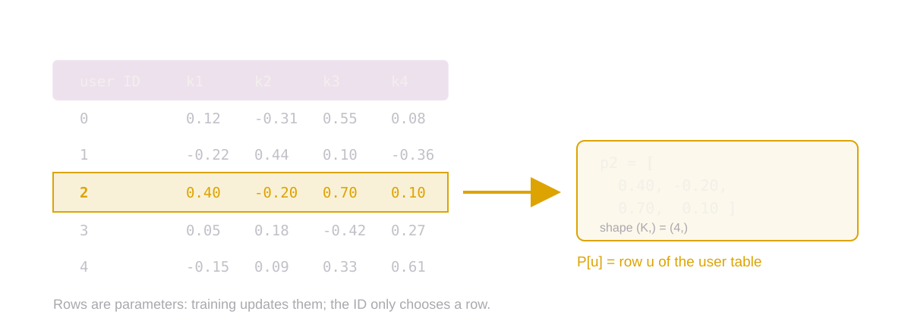

<div class="lesson-formula compact">$$u\longmapsto P[u]=p_u,\qquad i\longmapsto Q[i]=q_i$$</div>

<p class="lesson-takeaway">“Embedding” and “latent factor” describe the same kind of learned dense vector here.</p>

## One ID or a batch of IDs {.lesson-slide}

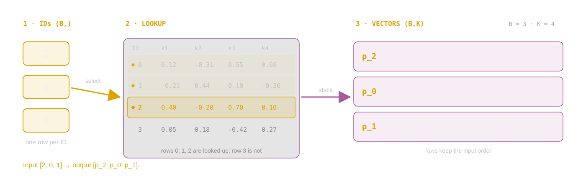

<p class="lesson-takeaway">A batch of IDs is a batch of lookups: the output is a matrix <code>(B,K)</code>.</p>

## Lookup equals a one-hot matrix product {.lesson-slide}

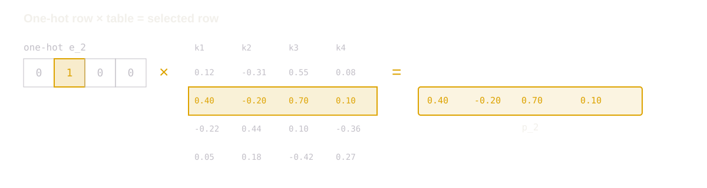

<p class="lesson-takeaway">The one-hot row explains the math; the embedding layer performs the lookup without building the zeros.</p>

## Embedding size is a choice; values are learned {.lesson-slide}

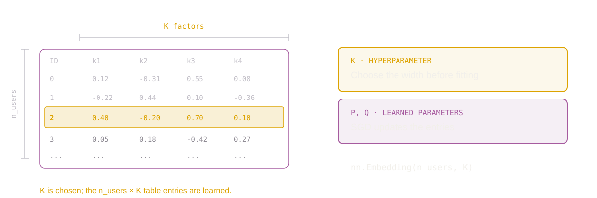

<p class="lesson-takeaway">ID numbers are lookup positions, not ordered measurements; K is chosen, and the table entries are learned.</p>

## MF is a tiny two-branch network {.lesson-slide}

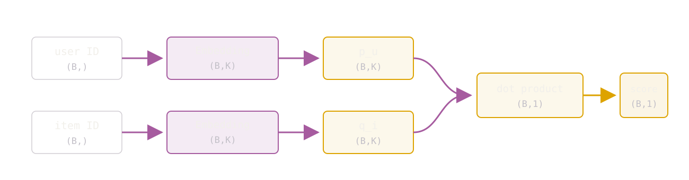

<div class="lesson-formula compact">$$u\to p_u,\quad i\to q_i,\quad (p_u,q_i)\to p_u^\top q_i$$</div>

<p class="lesson-takeaway">Turning MF into layers does not change its model: the interaction is still an inner product.</p>

## What changes in NCF? {.lesson-slide}

<p class="lesson-lede">MF learns good vectors, but it fixes how they combine. NCF keeps the vectors and learns the combination rule.</p>

<div class="lesson-grid three">
<div class="lesson-card"><span>MATRIX FACTORIZATION</span><b>Fixed bilinear rule</b><div class="lesson-formula compact">$$p_u^\top q_i=\sum_{k=1}^K p_{uk}q_{ik}$$</div><p>The score is a sum of coordinate-wise products; the rule is chosen before fitting.</p></div>
<div class="lesson-card"><span>WHY IT CAN FAIL</span><b>the score only sees a weighted sum</b><p>Take $p_u=(1,1)$. Items $(1,1)$ and $(2,0)$ both score $2$; a user may still prefer the balanced item—or the extreme one.</p></div>
<div class="lesson-card"><span>NEURAL COLLABORATIVE FILTERING</span><b>Learn the combination</b><div class="lesson-formula compact">$$\widehat r_{ui}=g_\theta([p_u,q_i])$$</div><p>The MLP can approximate a dot product, or learn a nonlinear rule that separates those items.</p></div>
</div>

<p class="lesson-takeaway">The embeddings are still learned; only the combination rule becomes a model. More flexibility is useful only if validation improves.</p>

## Follow one prediction through the NCF graph {.lesson-slide}

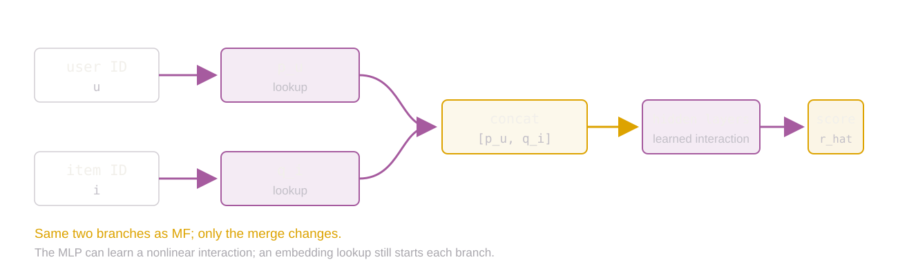

<p class="lesson-takeaway">Every observed rating sends an error signal through the hidden layers and back into the two embedding tables.</p>

## The shape contract for NCF {.lesson-slide}

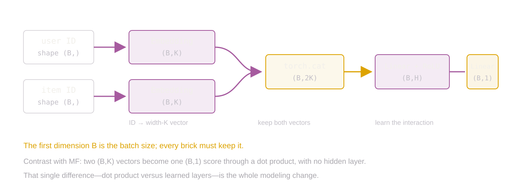

<p class="lesson-takeaway">Before training, check every brick: <code>(B,) → (B,K) → (B,2K) → (B,H) → (B,1)</code>.</p>

## NCF: four questions before code {.lesson-slide}

<div class="lesson-grid"><div class="lesson-card"><span>1 · DATA</span><b>observed (u,i,r) rows</b><p>A missing pair is not a zero rating.</p></div><div class="lesson-card"><span>2 · MODEL</span><b>$g_\theta([p_u,q_i])$</b><p>Lookup, concatenate, then an MLP.</p></div><div class="lesson-card"><span>3 · LOSS</span><b>MSE on observed ratings</b><p>Only training pairs enter the loss.</p></div><div class="lesson-card"><span>4 · OPTIMIZATION</span><b>SGD on all parameters</b><p>One optimizer updates tables and network.</p></div></div>

## The rating-regression criterion {.lesson-slide}

<div class="lesson-formula compact">$$\min_{P,Q,\theta}\;\frac{1}{\lvert\Omega_{\rm train}\rvert}\sum_{(u,i)\in\Omega_{\rm train}}\bigl(r_{ui}-g_\theta([p_u,q_i])\bigr)^2$$</div>

<div class="lesson-grid"><div class="lesson-card"><span>FIT</span><b>Training pairs only</b><p>Gradient updates use observed training ratings.</p></div><div class="lesson-card"><span>SELECT</span><b>Validation RMSE</b><p>Choose settings and the epoch budget without touching the final test labels.</p></div></div>

<p class="lesson-takeaway">This is the explicit-rating version used in STAT3009; the original NCF research also considers implicit feedback.</p>

## A PyTorch implementation sketch {.lesson-slide .lesson-code .ncf-dense}

```python
class NCF(nn.Module):
    def __init__(self, n_users, n_items, K=16):
        super().__init__()
        torch.manual_seed(0)
        self.user_emb = nn.Embedding(n_users, K)
        self.item_emb = nn.Embedding(n_items, K)
        self.net = nn.Sequential(
            nn.Linear(2 * K, 32), nn.ReLU(),
            nn.Linear(32, 1),
        )

    def forward(self, x):
        u = x[:, 0].long()
        i = x[:, 1].long()
        z = torch.cat([self.user_emb(u),
                       self.item_emb(i)], dim=1)
        return self.net(z)
```

<p class="lesson-takeaway">Both embedding tables and the MLP are trained by the same loss.</p>

## Keep the familiar bias terms {.lesson-slide}

<div class="lesson-formula">$$\widehat r_{ui}=\mu+a_u+b_i+g_\theta([p_u,q_i])$$</div>

<div class="lesson-grid three"><div class="lesson-card"><span>BRANCH 1</span><b>user ID</b><p>Look up $a_u$ and $p_u$.</p></div><div class="lesson-card"><span>BRANCH 2</span><b>item ID</b><p>Look up $b_i$ and $q_i$.</p></div><div class="lesson-card"><span>COMBINE</span><b>add + network</b><p>Start from the bias baseline, then let the network learn the interaction.</p></div></div>

<p class="lesson-takeaway">Adding the familiar bias terms gives the network a sensible starting point and isolates the interaction.</p>

## Biased NCF in PyTorch {.lesson-slide .lesson-code .nn-code-sm}

```python
class BiasedNCF(nn.Module):
    def __init__(self, n_users, n_items, K=16, mu=0.0):
        super().__init__()
        torch.manual_seed(0)
        self.user_emb = nn.Embedding(n_users, K)
        self.item_emb = nn.Embedding(n_items, K)
        self.user_bias = nn.Embedding(n_users, 1)
        self.item_bias = nn.Embedding(n_items, 1)
        self.mu = nn.Parameter(torch.tensor([mu]))
        self.net = nn.Sequential(
            nn.Linear(2 * K, 32), nn.ReLU(),
            nn.Linear(32, 16), nn.ReLU(),
            nn.Linear(16, 1),
        )

    def forward(self, x):
        u = x[:, 0].long()
        i = x[:, 1].long()
        z = torch.cat([self.user_emb(u),
                       self.item_emb(i)], dim=1)
        return (self.mu + self.user_bias(u)
                + self.item_bias(i) + self.net(z))
```

<p class="lesson-takeaway">The four embedding tables and the MLP are registered in one <code>Module</code>; one optimizer updates all of them.</p>

## Add a nonlinear correction, keep MF {.lesson-slide}

<div class="lesson-formula">$$\widehat r_{ui}=\mu+a_u+b_i+p_u^\top q_i+h_\phi([s_u,t_i])$$</div>

<div class="lesson-grid"><div class="lesson-card"><span>MF PATH</span><b>first-order interaction</b><p>$p_u^\top q_i$ retains the simple, interpretable matching mechanism.</p></div><div class="lesson-card"><span>NEURAL PATH</span><b>additional interaction</b><p>Separate embeddings $s_u,t_i$ feed a nonlinear correction.</p></div></div>

<p class="lesson-takeaway">This additive extension is useful when a dot product captures part of the pattern but leaves structured residuals.</p>

## Additive NCF in PyTorch {.lesson-slide .lesson-code .nn-code-sm}

```python
class ANCF(nn.Module):
    def __init__(self, n_users, n_items, K=16, R=8, mu=0.0):
        super().__init__()
        torch.manual_seed(0)
        self.user_emb = nn.Embedding(n_users, K)
        self.item_emb = nn.Embedding(n_items, K)
        self.user_neural = nn.Embedding(n_users, R)
        self.item_neural = nn.Embedding(n_items, R)
        self.user_bias = nn.Embedding(n_users, 1)
        self.item_bias = nn.Embedding(n_items, 1)
        self.mu = nn.Parameter(torch.tensor([mu]))
        self.net = nn.Sequential(
            nn.Linear(2 * R, 32), nn.ReLU(),
            nn.Linear(32, 1),
        )

    def forward(self, x):
        u = x[:, 0].long()
        i = x[:, 1].long()
        mf = (self.user_emb(u) * self.item_emb(i)).sum(
            dim=1, keepdim=True)
        z = torch.cat([self.user_neural(u),
                       self.item_neural(i)], dim=1)
        return (self.mu + self.user_bias(u)
                + self.item_bias(i) + mf + self.net(z))
```

## The same skorch wrapper trains NCF {.lesson-slide .lesson-code .nn-code-sm}

```python
ncf = NeuralNetRegressor(
    module=BiasedNCF,
    module__n_users=n_users,
    module__n_items=n_items,
    module__mu=mu,
    criterion=nn.MSELoss,
    optimizer=torch.optim.SGD,
    optimizer__lr=0.05,
    max_epochs=50,
    batch_size=256,
    iterator_train__shuffle=True,
    train_split=ValidSplit(0.1, random_state=0),
)
ncf.fit(X_train, y_train)
```

<p class="lesson-takeaway">The <code>module__</code> prefix passes constructor arguments; the rest is the same skorch wrapper used in the previous deck.</p>

## A more flexible path is optional {.lesson-slide}

<div class="lesson-formula compact">$$\widehat r_{ui}=\phi\!\left([\,p_u\circ q_i,\;\psi([s_u,t_i])\,]\right)$$</div>

<div class="lesson-grid"><div class="lesson-card"><span>$p_u\circ q_i$</span><b>coordinate-wise products</b><p>Keep explicit factor interactions as inputs.</p></div><div class="lesson-card"><span>$\psi,\phi$</span><b>learned nonlinear functions</b><p>Let the network combine those interactions with another representation.</p></div></div>

<p class="lesson-takeaway">This extension has more parameters and more design choices; it needs the same careful validation as the simpler models.</p>

## When the ID is new {.lesson-slide}

<div class="lesson-grid"><div class="lesson-card"><span>KNOWN ID</span><b>Embedding row exists</b><p>Look up its learned vector and predict.</p></div><div class="lesson-card"><span>NEW ID</span><b>No learned row yet</b><p>The ID-only NCF model cannot infer a personalized vector from an unseen ID.</p></div></div>

<p class="lesson-takeaway">Side information—user or item features—offers a way to construct a representation for a new entity. That is the next lecture.</p>

## Coding break: run the NCF pipeline {.lesson-slide .coding-break}

<div class="coding-cue">
  <span class="coding-cue-kicker">PAUSE · CODING BREAK · 8–10 MIN</span>
  <b>Switch to <code>nb/STAT3009_NCF.ipynb</code></b>
  <p>Run the notebook in order. Come back when the comparison table is on screen.</p>
</div>

<div class="lesson-grid three">
  <div class="lesson-card"><span>1 · DATA</span><b>Section 2</b><p>Load the Netflix split, encode IDs, and print the shapes.</p></div>
  <div class="lesson-card"><span>2 · MODELS</span><b>Sections 3–5</b><p>Run <code>MFNet</code>, <code>BiasedNCF</code>, and <code>ANCF</code>; check every output shape.</p></div>
  <div class="lesson-card"><span>3 · TRAIN</span><b>Section 6</b><p>Fit all three for 50 epochs and display the comparison table.</p></div>
</div>

<p class="lesson-takeaway">When you return, we will read the validation curves and the test RMSE together.</p>

::: {.notes}
[Teaching] Pause the slides here. Open the notebook and run Sections 2–6. The goal is to show the shape checks and the training loop, not to wait for every epoch. If time is tight, run the cells before class and show the saved outputs.
:::

## What to expect: MF vs NCF {.lesson-slide}

<table class="lesson-table"><thead><tr><th>model</th><th>interaction</th><th>flexibility</th><th>example test RMSE</th></tr></thead><tbody>
<tr><td>Biased MF</td><td>$p_u^\top q_i$</td><td>fixed</td><td>0.972</td></tr>
<tr><td>NCF</td><td>$g_\theta([p_u,q_i])$</td><td>learned</td><td>0.961</td></tr>
<tr><td>Additive NCF</td><td>$p_u^\top q_i+h_\phi([s_u,t_i])$</td><td>both paths</td><td>0.960</td></tr>
</tbody></table>

<p class="lesson-takeaway">The example is one fixed 50-epoch budget on the course split. More flexibility is not automatically better; validation decides.</p>

## More flexibility can overfit {.lesson-slide}

<div class="chart-two-col">
<div>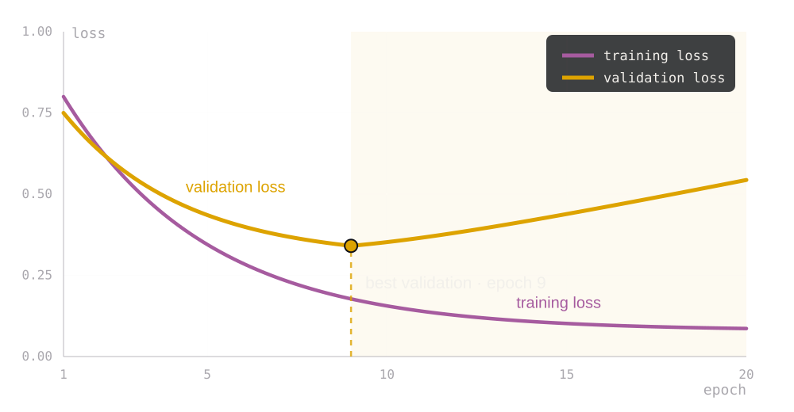</div>
<div class="lesson-stack">
<div class="lesson-card"><span>WHAT THE CURVES SHOW</span><b>training falls faster</b><p>NCF has more parameters; it can memorize observed pairs.</p></div>
<div class="lesson-card"><span>WHAT TO DO</span><b>choose on validation</b><p>Keep the test set closed until the final comparison.</p></div>
</div>
</div>

<p class="lesson-takeaway">The learned interaction helps only when validation improves; otherwise the simpler dot product is the better model.</p>

## The thread from MF to NCF {.lesson-slide}

<div class="lesson-flow"><div>MF<br><b>dot product</b></div><i>→</i><div>embedding layers<br><b>same factors</b></div><i>→</i><div>NCF<br><b>learned interaction</b></div><i>→</i><div>side information<br><b>new IDs</b></div></div>

<p class="lesson-takeaway">For each new model, ask again: <b>data, model, loss, optimization</b>—and then ask how you will validate it.</p>

## In-class practice: build an NCF {.lesson-slide}

<p class="lesson-lede">Open <code>nb/STAT3009_NCF.ipynb</code>, Section 7. Work in pairs for 20 minutes. The grid uses 30 epochs to stay fast; the comparison above uses 50.</p>

<ol class="lesson-list">
<li>Train the provided <code>BiasedNCF</code> for 50 epochs; plot training and validation RMSE.</li>
<li>Change $K$ from 16 to 8 and re-fit; compare validation RMSE.</li>
<li>Add one hidden layer or change its width; does validation improve?</li>
<li>Report the test RMSE of your best model and one sentence explaining the choice.</li>
</ol>

<p class="lesson-takeaway">Compare candidate models on validation; open the test labels only once, at the end.</p>

## Practice debrief {.lesson-slide}

<div class="lesson-grid three"><div class="lesson-card"><span>CAPACITY</span><b>more units ≠ better</b><p>Bigger models can fit training noise and lose on validation.</p></div><div class="lesson-card"><span>EMBEDDINGS</span><b>$K$ is a hyperparameter</b><p>Too small underfits; too large overfits the sparse table.</p></div><div class="lesson-card"><span>SELECTION</span><b>validation, then test</b><p>Pick the epoch budget and architecture on validation; report test once.</p></div></div>

<p class="lesson-takeaway">NCF is still a regression model: the same data, loss, and optimization questions apply.</p>

## CV snapshot: NCF over $K$ and hidden {.lesson-slide}

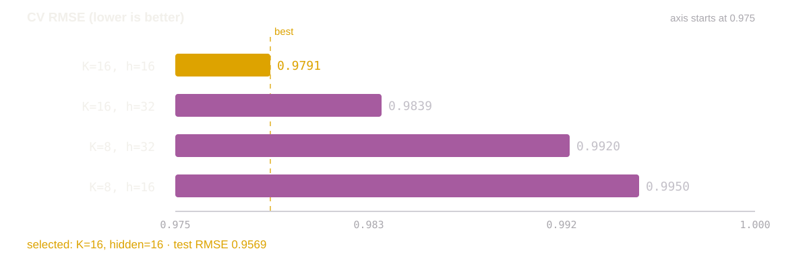

<div class="lesson-grid"><div class="lesson-card"><span>SELECTED</span><b>$K=16,\ \mathrm{hidden}=32$</b><p>Lowest mean CV RMSE; <code>refit=True</code> refits it on all training rows.</p></div><div class="lesson-card"><span>TEST RMSE</span><b>0.9659</b><p>The search uses 30 epochs; the fixed comparison uses 50.</p></div></div>

<p class="lesson-takeaway">CV ranks candidates; it is not a test score. The search budget also matters.</p>

## Extra practice: change the merge {.lesson-slide}

<p class="lesson-lede">Keep the two embedding branches; change only how they meet. Section 8 of the notebook has skeletons and solutions.</p>

<div class="lesson-grid three">
<div class="lesson-card"><span>GMF</span><b>elementwise product</b><p>$p_u\odot q_i$ → a linear head. MF fixes the head weights to 1; GMF learns them.</p></div>
<div class="lesson-card"><span>TWO-TOWER</span><b>separate MLPs</b><p>User and item embeddings go through separate towers, then a dot product.</p></div>
<div class="lesson-card"><span>NEUMF</span><b>two parallel paths</b><p>Concatenate the GMF vector and the MLP vector, then a final linear layer.</p></div>
</div>

<p class="lesson-takeaway">Optional / take-home. All three reuse the same training and validation recipe; only the merge changes.</p>

## Carry the template forward {.lesson-slide}

<table class="lesson-table"><thead><tr><th>question</th><th>MF</th><th>NCF</th></tr></thead><tbody>
<tr><td>Data</td><td>observed (u,i,r) rows</td><td>same rows</td></tr>
<tr><td>Model</td><td>dot product</td><td>embeddings + concat + MLP</td></tr>
<tr><td>Loss</td><td>MSE on observed ratings</td><td>same loss</td></tr>
<tr><td>Optimization</td><td>SGD + backprop</td><td>same optimizer</td></tr>
<tr><td>Evaluation</td><td>validation curve + CV</td><td>same evaluation</td></tr>
</tbody></table>

<p class="lesson-takeaway">Only the interaction changes; the data, loss, optimizer, and evaluation stay the same.</p>

## What you should be able to do now {.lesson-slide}

<div class="lesson-grid"><div class="lesson-card"><span>BUILD</span><b>an embedding layer</b><p>Turn integer user and item IDs into learned dense vectors.</p></div><div class="lesson-card"><span>COMBINE</span><b>MF and a network</b><p>Use <code>torch.cat</code> and an MLP to learn the interaction.</p></div><div class="lesson-card"><span>COMPARE</span><b>MF vs NCF</b><p>Decide whether the learned interaction improves validation RMSE.</p></div><div class="lesson-card"><span>DIAGNOSE</span><b>overfitting</b><p>Compare training and validation curves before opening the test set.</p></div></div>

## Exit ticket {.lesson-slide}

<ol class="lesson-list">
<li>Why can an embedding layer be viewed as a one-hot matrix product?</li>
<li>What does <code>torch.cat</code> do in NCF, and what is the resulting shape?</li>
<li>What changes from MF to NCF, and what stays the same?</li>
<li>Why must the validation set stay out of the gradient updates?</li>
<li>What happens when a user or item ID was never seen during training?</li>
<li>Why might MF beat NCF on a sparse dataset?</li>
</ol>

<p class="lesson-takeaway">If you can answer these six questions, you can reproduce the notebook from scratch.</p>

## Embedding is a core NLP module {.lesson-slide}

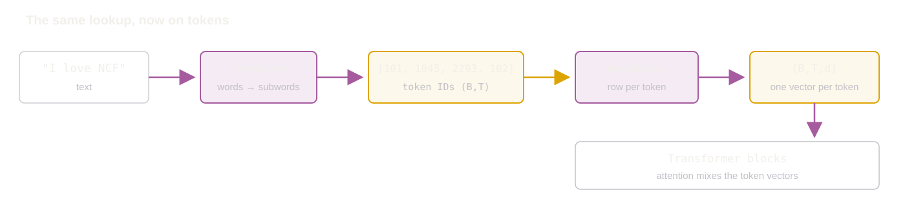

<p class="lesson-takeaway">NCF: one ID → one vector. NLP: a sequence of token IDs → a sequence of vectors, shape <code>(B,T,d)</code>.</p>

## Where LLMs use embeddings {.lesson-slide}

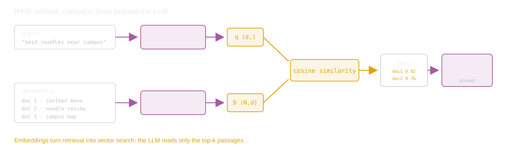

<div class="lesson-grid three">
<div class="lesson-card"><span>SEMANTIC SEARCH</span><b>query → documents</b><p>Nearest vectors in one shared space.</p></div>
<div class="lesson-card"><span>CLUSTERING</span><b>group similar items</b><p>Use the same vectors for unsupervised grouping.</p></div>
<div class="lesson-card"><span>RECOMMENDATION</span><b>user + item vectors</b><p>The NCF idea, now with text or side features.</p></div>
</div>

<p class="lesson-takeaway">RAG is one application; the same embeddings support search, clustering, and recommendation.</p>

## Next: side information {.lesson-slide}

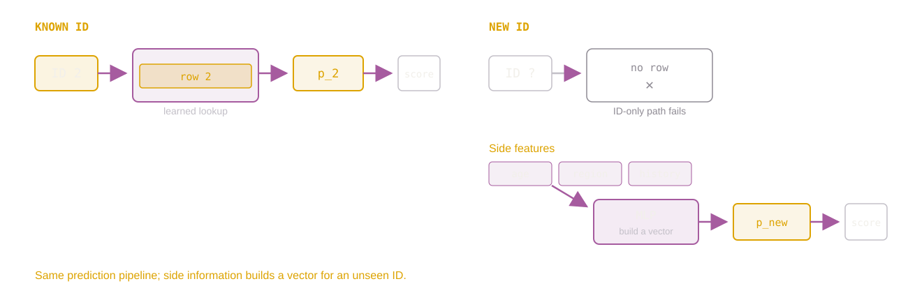

<p class="lesson-takeaway">An ID-only model cannot represent an unseen user or item; side features can build the vector instead.</p>
