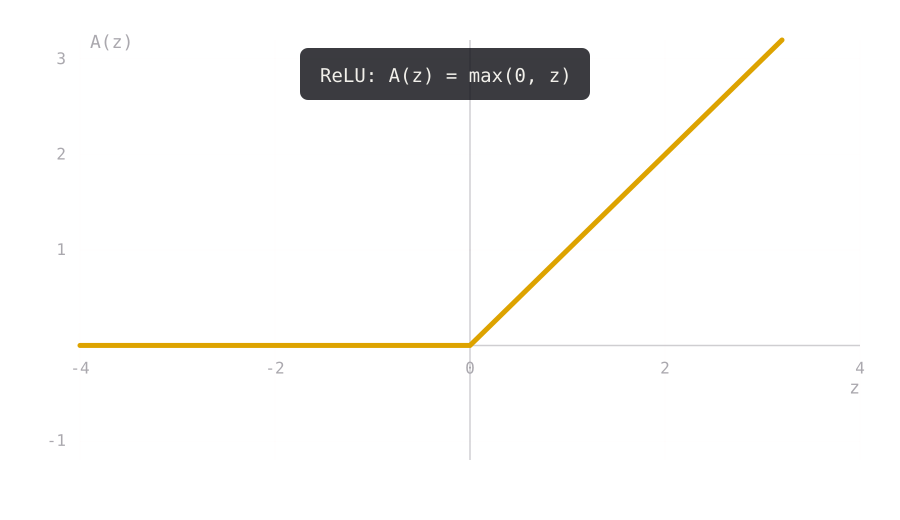
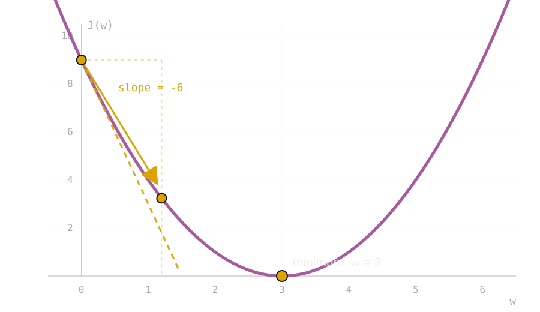
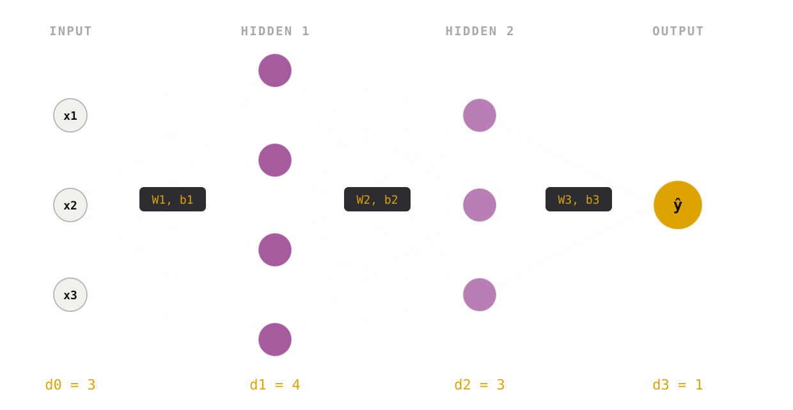
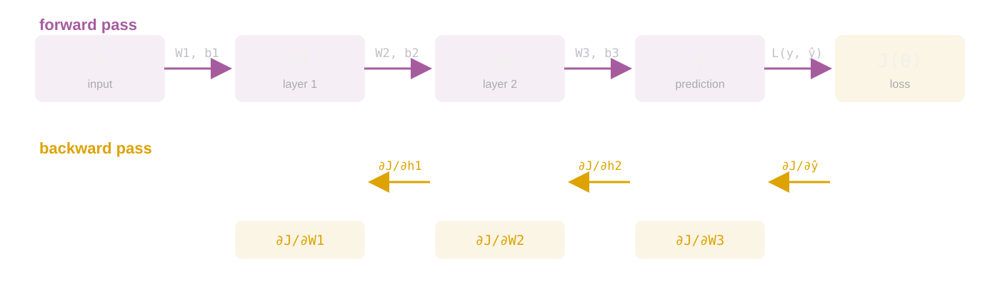
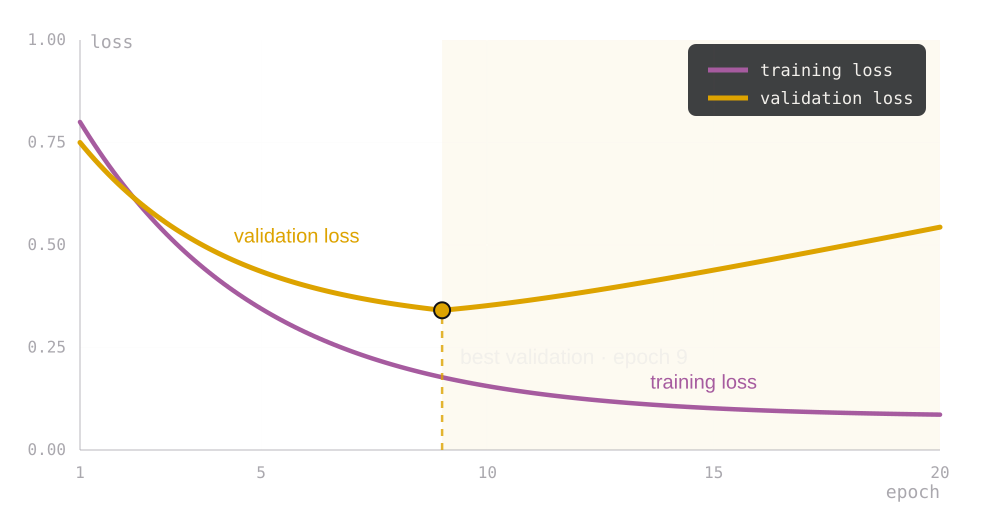

## Recall: the linear model {.lesson-slide}

<div class="lesson-formula">$$\widehat y_i=x_i^\top w+b,\qquad J(w,b)=\frac1n\sum_{i=1}^n\bigl(y_i-x_i^\top w-b\bigr)^2$$</div>

<div class="lesson-grid"><div class="lesson-card"><span>MODEL</span><b>one linear layer</b><p>Each feature contributes through one learned coefficient.</p></div><div class="lesson-card"><span>OBJECTIVE</span><b>mean squared error</b><p>Training chooses $w,b$ to minimize the average squared error on the training rows.</p></div></div>

<p class="lesson-takeaway">Same data, same loss, same training question: minimize an average loss over the training set.</p>

::: {.notes}
[Teaching] Connect to the ML I lecture: `LinearRegression` solves this objective. The point is not the closed-form solution; the point is the pattern “model + average loss”.
:::

## From linear to nonlinear {.lesson-slide}

<div class="lesson-formula">$$h=A(W_1x+b_1),\qquad \widehat y=W_2h+b_2$$</div>

<div class="lesson-grid"><div class="lesson-card"><span>LINEAR MODEL</span><b>$x^\top w+b$</b><p>One fixed transformation; features enter additively.</p></div><div class="lesson-card"><span>NEURAL MODEL</span><b>$f_\theta(x)$</b><p>Several learned transformations, with nonlinearities between them.</p></div></div>

<p class="lesson-takeaway">The objective is unchanged. We only make the prediction rule $f_\theta$ more flexible.</p>

## Why use a nonlinear activation? {.lesson-slide}

<div class="nn-two-col">
<div class="nn-stack">
<div class="lesson-card"><span>WITHOUT NONLINEARITY</span><b>Two linear layers collapse to one</b><div class="lesson-formula compact">$$W_2(W_1x+b_1)+b_2=Wx+c$$</div></div>
<div class="lesson-card"><span>WITH NONLINEARITY</span><b>The composition can bend</b><div class="lesson-formula compact">$$h=A(W_1x+b_1),\quad\widehat y=W_2h+b_2$$</div></div>
</div>

</div>

<p class="lesson-takeaway">ReLU, $A(z)=\max(0,z)$, is the default nonlinearity in this course: cheap, simple, and enough to stop layers collapsing.</p>

## The training problem {.lesson-slide}

<div class="lesson-formula">$$J(\theta)=\frac1n\sum_{i=1}^n L\bigl(y_i,f_\theta(x_i)\bigr)$$</div>

<div class="lesson-grid four"><div class="lesson-card"><span>DATA</span><b>$(x_i,y_i)$</b><p>$n$ training examples: features $x_i$ and target $y_i$.</p></div><div class="lesson-card"><span>MODEL</span><b>$f_\theta$</b><p>A prediction rule with parameters $\theta$.</p></div><div class="lesson-card"><span>LOSS</span><b>$L(y,\widehat y)$</b><p>How wrong one prediction is; for ratings, squared error.</p></div><div class="lesson-card"><span>OBJECTIVE</span><b>$J(\theta)$</b><p>The average loss over the training set; training minimizes it.</p></div></div>

<p class="lesson-takeaway">Everything that follows is about minimizing $J(\theta)$: define $f_\theta$, choose $L$, and update $\theta$.</p>

::: {.notes}
[Teaching] Put the objective on the board first. The four implementation modules later are just the code homes for these four objects: data, model, loss, and the optimizer that minimizes the objective.
:::

## Full-batch gradient descent {.lesson-slide}

<div class="lesson-formula compact">$$\theta^{(t+1)}=\theta^{(t)}-\eta\,\frac1n\sum_{i=1}^n\nabla_\theta L\bigl(y_i,f_\theta(x_i)\bigr)$$</div>

<div class="lesson-grid three"><div class="lesson-card"><span>CURRENT</span><b>$\theta^{(t)}$</b><p>The network's weights right now.</p></div><div class="lesson-card"><span>DIRECTION</span><b>gradient</b><p>How the loss changes when each weight moves.</p></div><div class="lesson-card"><span>STEP SIZE</span><b>$\eta$</b><p>The learning rate controls how far we move.</p></div></div>

<p class="lesson-takeaway">This is exact, but one step uses all $n$ training examples. That is expensive when $n$ is large.</p>

## One small gradient step {.lesson-slide}

<div class="nn-two-col">
<div>
<p class="lesson-lede">For $J(w)=(w-3)^2$, start at $w=0$ and choose $\eta=0.2$.</p>
<div class="lesson-formula compact">$$J'(w)=2(w-3),\qquad w_{\mathrm{new}}=0-0.2(-6)=1.2$$</div>
<table class="lesson-table"><thead><tr><th>point</th><th>weight</th><th>loss</th></tr></thead><tbody><tr><td>before</td><td>$0$</td><td>$9$</td></tr><tr><td>after one step</td><td>$1.2$</td><td>$3.24$</td></tr><tr><td>minimum</td><td>$3$</td><td>$0$</td></tr></tbody></table>
</div>

</div>

<p class="lesson-takeaway">The same idea updates all network weights at once; the gradient is then a large vector, not a single slope.</p>

## Gradient descent in higher dimensions {.lesson-slide}

<p class="lesson-lede">Minimize $L(\theta_1,\theta_2)=\theta_1^2+\theta_2^2$ with $\eta=0.2$ from $\theta^{(0)}=(2,1)$.</p>

<div class="nn-two-col">
<div class="lesson-formula compact">$$\nabla L(\theta)=\begin{pmatrix}2\theta_1\\2\theta_2\end{pmatrix},\qquad \theta^{(t+1)}=\theta^{(t)}-\eta\nabla L(\theta^{(t)})$$</div>
<table class="lesson-table"><thead><tr><th>$t$</th><th>$\theta_1$</th><th>$\theta_2$</th><th>$L$</th></tr></thead><tbody><tr><td>0</td><td>2.00</td><td>1.00</td><td>5.00</td></tr><tr><td>1</td><td>1.20</td><td>0.60</td><td>1.80</td></tr><tr><td>2</td><td>0.72</td><td>0.36</td><td>0.65</td></tr><tr><td>3</td><td>0.43</td><td>0.22</td><td>0.23</td></tr><tr><td>4</td><td>0.26</td><td>0.13</td><td>0.08</td></tr></tbody></table>
</div>

<p class="lesson-takeaway">The gradient is a vector: one partial derivative per parameter. A single learning rate must balance all directions; that is why $\eta$ is so important.</p>

## Why use a mini-batch? {.lesson-slide}

<p class="lesson-lede">Write the per-example loss as $\ell_i(\theta)=L(y_i,f_\theta(x_i))$<br>The full gradient is an average over all $n$ examples.</p>

<div class="lesson-formula compact">$$\nabla J(\theta)=\frac1n\sum_{i=1}^n\nabla_\theta\ell_i(\theta),\qquad \mathbb{E}_B\bigl[\nabla J_B(\theta)\bigr]=\nabla J(\theta)$$</div>

<div class="lesson-grid three"><div class="lesson-card"><span>FULL GRADIENT</span><b>exact, cost $O(n)$</b><p>One update needs all $n$ rows.</p><div class="dot-row"><span class="dot active"></span><span class="dot active"></span><span class="dot active"></span><span class="dot active"></span><span class="dot active"></span><span class="dot active"></span><span class="dot active"></span><span class="dot active"></span><span class="dot active"></span><span class="dot active"></span><span class="dot active"></span><span class="dot active"></span></div></div><div class="lesson-card"><span>BATCH GRADIENT</span><b>unbiased, cost $O(b)$</b><p>A uniformly sampled batch estimates the full gradient.</p><div class="dot-row"><span class="dot active"></span><span class="dot active"></span><span class="dot active"></span><span class="dot active"></span><span class="dot"></span><span class="dot"></span><span class="dot"></span><span class="dot"></span><span class="dot"></span><span class="dot"></span><span class="dot"></span><span class="dot"></span></div></div><div class="lesson-card"><span>TRADE-OFF</span><b>noise vs cost</b><p>Small $b$: noisy but cheap. Large $b$: expensive but less noisy.</p></div></div>

<p class="lesson-takeaway">A mini-batch turns one expensive exact step into many cheap noisy steps. The noise is the price of not touching all $n$ rows.</p>

::: {.notes}
[Teaching] This is the key transition. A batch gradient is a sample mean of per-example gradients; the full gradient is the population mean. It is unbiased when rows are sampled uniformly, and its variance decreases roughly as $1/b$. We trade gradient noise for many more updates per pass over the data.
:::

## SGD: one batch at a time {.lesson-slide}

<p class="lesson-lede">A batch $B$ is a subset of the training rows. Replace the full average by the average over $B$.</p>

<div class="lesson-formula compact">$$\nabla J_B(\theta)=\frac1{|B|}\sum_{j\in B}\nabla_\theta L\bigl(y_j,f_\theta(x_j)\bigr),\qquad \theta\leftarrow\theta-\eta\nabla J_B(\theta)$$</div>

<div class="lesson-grid four"><div class="lesson-card"><span>FULL BATCH</span><b>all $n$ rows</b><p>Exact gradient, but one step costs a full pass over the data.</p></div><div class="lesson-card"><span>MINI-BATCH</span><b>$b$ rows</b><p>The usual SGD compromise: a noisy but cheap gradient, many updates per epoch.</p></div><div class="lesson-card"><span>SINGLE SAMPLE</span><b>$b=1$</b><p>Very noisy gradient, but the cheapest possible update.</p></div><div class="lesson-card"><span>EPOCH</span><b>one pass</b><p>Uses every training row once on average; with batch size $b$, about $n/b$ updates.</p></div></div>

<p class="lesson-takeaway">A batch is the set of rows used for <b>one</b> update; an epoch is one pass over all rows.</p>


## One batch, one update; one epoch, many updates {.lesson-slide}

<div class="batch-visual">
<div class="batch-group"><span class="row"></span><span class="row"></span><span class="row"></span><span class="row"></span><b>batch 1</b><small>4 rows → update 1</small></div>
<i class="batch-arrow">→</i>
<div class="batch-group"><span class="row"></span><span class="row"></span><span class="row"></span><span class="row"></span><b>batch 2</b><small>4 rows → update 2</small></div>
<i class="batch-arrow">→</i>
<div class="batch-group"><span class="row"></span><span class="row"></span><span class="row"></span><span class="row"></span><b>batch 3</b><small>4 rows → update 3</small></div>
</div>

<p class="batch-caption">Illustrative example: 12 rows, batch size 4, so one epoch has 3 updates.</p>

<p class="lesson-takeaway">A batch gives <b>one</b> gradient step. An epoch is one pass over all rows, so it gives about $n/b$ steps.</p>

::: {.notes}
[Teaching] Point to one block at a time: each block is a mini-batch, each arrow is one optimizer step, and the three blocks together are one epoch.
:::

## SGD terminology {.lesson-slide}

<table class="lesson-table"><thead><tr><th>term</th><th>meaning</th></tr></thead><tbody>
<tr><td>loss $L$</td><td>error for one prediction</td></tr>
<tr><td>objective $J$</td><td>average loss over the training set</td></tr>
<tr><td>gradient</td><td>derivative of the objective with respect to the parameters</td></tr>
<tr><td>batch</td><td>the subset of rows used for one update</td></tr>
<tr><td>batch size $b$</td><td>number of rows in that subset</td></tr>
<tr><td>iteration / step</td><td>one gradient update, using one batch</td></tr>
<tr><td>epoch</td><td>one pass over the training set; about $n/b$ updates</td></tr>
<tr><td>learning rate $\eta$</td><td>step size in the parameter update</td></tr>
<tr><td>shuffle</td><td>reshuffle row order each epoch, changing the batches</td></tr>
</tbody></table>

<p class="lesson-takeaway">A batch is not a model and not a dataset: it is the set of rows used for <b>one</b> SGD step.</p>

## From matrix factorization to a learned interaction {.lesson-slide}

<div class="lesson-kicker">BACK TO RECOMMENDATION</div>

<div class="lesson-formula">$$\widehat r_{ui}=p_u^\top q_i\qquad\longrightarrow\qquad\widehat r_{ui}=f_\theta(p_u,q_i)$$</div>

<div class="lesson-grid"><div class="lesson-card"><span>MATRIX FACTORIZATION</span><b>Fixed interaction rule</b><p>Learn two vectors and combine them with an inner product.</p></div><div class="lesson-card"><span>NEURAL MODEL</span><b>Learn the interaction rule</b><p>A network can combine the same inputs through several linear and nonlinear steps.</p></div></div>

<p class="lesson-takeaway">The ratings, the loss, and the validation discipline stay the same. <b>The function class changes.</b></p>

::: {.notes}
[Teaching] Review the MF deck's two-factor example first. “Nonlinear” means the combination rule is no longer restricted to a single dot product.
:::

## The four questions and their implementation modules {.lesson-slide}

<div class="lesson-grid four"><div class="lesson-card"><span>Q1 · DATA</span><b>examples → batches</b><p><code>TensorDataset</code> + <code>DataLoader</code></p></div><div class="lesson-card"><span>Q2 · MODEL</span><b>layers → $f_\theta$</b><p><code>nn.Linear</code>, <code>nn.ReLU</code>, <code>nn.Sequential</code>, <code>nn.Module</code></p></div><div class="lesson-card"><span>Q3 · LOSS</span><b>prediction → number</b><p><code>nn.MSELoss</code></p></div><div class="lesson-card"><span>Q4 · OPTIMIZATION</span><b>gradient → update</b><p><code>torch.optim.SGD</code> + training loop</p></div></div>

<p class="lesson-takeaway">Each question has a code home. <b>Evaluation</b> is the check after the four modules: validation and RMSE/MAE.</p>

::: {.notes}
[Teaching] The old four questions (Model, Learned, Hyperparameters, Loss) are still the reading template; the last slide maps them onto these implementation modules.
:::

## Q1 · Data: what goes into the model? {.lesson-slide}

<div class="lesson-kicker">MODULE 1 · DATA</div>

<div class="lesson-grid"><div class="lesson-card"><span>QUESTION</span><b>What examples, and how are they batched?</b><p>Rows contain features and a target; training consumes small batches, not the whole table.</p></div><div class="lesson-card"><span>IMPLEMENTATION</span><b><code>TensorDataset</code> + <code>DataLoader</code></b><p>Convert rows to tensors, pair $x_i$ with $y_i$, then yield mini-batches.</p></div></div>

<p class="lesson-takeaway">The data module's output is a stream of `(xb, yb)` batches with a known shape.</p>

## The PyTorch data pipeline {.lesson-slide .lesson-code}

```python
from torch.utils.data import DataLoader, TensorDataset

X = torch.tensor(X_train, dtype=torch.float32)
y = torch.tensor(y_train, dtype=torch.float32).unsqueeze(1)
loader = DataLoader(TensorDataset(X, y),
                    batch_size=64, shuffle=True)
```

<div class="lesson-grid three"><div class="lesson-card"><span>TENSOR</span><b>$(n,8)$ and $(n,1)$</b><p>Features are float32; targets match the model output shape.</p></div><div class="lesson-card"><span>DATASET</span><b>one example per row</b><p>`TensorDataset` pairs each $x_i$ with its $y_i$.</p></div><div class="lesson-card"><span>LOADER</span><b>mini-batches</b><p>`shuffle=True` reshuffles every epoch; `batch_size` is a hyperparameter.</p></div></div>

<p class="lesson-takeaway">The loader yields `(xb, yb)` with shapes `(64,8)` and `(64,1)`; the training loop consumes those batches.</p>

## Q2 · Model: what is $f_\theta$? {.lesson-slide}

<div class="lesson-kicker">MODULE 2 · MODEL</div>

<div class="lesson-grid"><div class="lesson-card"><span>QUESTION</span><b>What prediction rule does the network represent?</b><p>A composition of learned linear maps and fixed nonlinear activations.</p></div><div class="lesson-card"><span>IMPLEMENTATION</span><b><code>nn.Module</code> + layers</b><p>Pick bricks, check their shapes, then snap them together with <code>Sequential</code> or a custom <code>Module</code>.</p></div></div>

<p class="lesson-takeaway">Think of a model as a row of bricks: each brick transforms the tensor and passes it to the next.</p>

## A neural network is a chain of transformations {.lesson-slide}

<div class="lesson-flow"><div><b>input</b><br>$x$</div><i>→</i><div><b>hidden layer 1</b><br>features</div><i>→</i><div><b>hidden layer 2</b><br>combinations</div><i>→</i><div><b>output</b><br>$\widehat y$</div></div>

<div class="lesson-grid"><div class="lesson-card"><span>LINEAR STEP</span><b>$Wx+b$</b><p>Mix the inputs and shift the result.</p></div><div class="lesson-card"><span>NONLINEAR STEP</span><b>activation $A(\cdot)$</b><p>Let the next layer respond differently in different input regions.</p></div></div>

<p class="lesson-takeaway">“Deep” means we compose several layers; each layer creates the input for the next.</p>

## Start with one neuron {.lesson-slide}

<div class="lesson-formula">$$z=w_1x_1+w_2x_2+b,\qquad h=A(z)$$</div>

<div class="lesson-grid three"><div class="lesson-card"><span>INPUTS</span><b>$x_1,x_2$</b><p>Values supplied for one example.</p></div><div class="lesson-card"><span>LEARNED</span><b>$w_1,w_2,b$</b><p>Weights and bias adjusted during fitting.</p></div><div class="lesson-card"><span>OUTPUT</span><b>$h$</b><p>The transformed signal sent forward.</p></div></div>

<p class="lesson-takeaway">A layer contains many neurons; the layer's outputs form a vector.</p>

## Stack neurons into layers {.lesson-slide}



<div class="lesson-formula compact nn-tight-formula">$$W_1\in\mathbb R^{4\times3},\qquad W_2\in\mathbb R^{3\times4},\qquad W_3\in\mathbb R^{1\times3}$$</div>

<p class="lesson-takeaway">Each edge is a weight, and each node adds a bias before applying $A$. This toy network has <b>35 learned numbers</b>: $(4\cdot3+4)+(3\cdot4+3)+(1\cdot3+1)$.</p>

::: {.notes}
[Teaching] The figure is schematic: nodes are neurons, edges are scalar weights, and the labels $W_\ell,b_\ell$ name the whole layer's parameters. Count parameters with the students before advancing.
:::

## The model in one line {.lesson-slide}

<div class="lesson-formula">$$f_0(x)=x,\qquad f_\ell(x)=A_\ell\bigl(W_\ell f_{\ell-1}(x)+b_\ell\bigr),\quad \ell=1,\ldots,L$$</div>

<div class="lesson-grid"><div class="lesson-card"><span>HIDDEN LAYERS</span><b>Usually nonlinear</b><p>They build an internal representation of the input.</p></div><div class="lesson-card"><span>OUTPUT LAYER</span><b>Chosen for the task</b><p>For numerical rating prediction, a linear output is a simple starting point.</p></div></div>

<p class="lesson-takeaway">The network's output is $\widehat y=f_L(x)$; training decides the values inside its weight matrices and bias vectors.</p>

## Inside a `nn.Linear` brick {.lesson-slide}

<div class="nn-two-col">
<div class="brick-large brick linear"><span>ONE LAYER</span><b>nn.Linear(8, 32)</b><small>W: 32 × 8 &nbsp; · &nbsp; b: 32</small><div class="shape">in (B,8) → out (B,32)</div></div>
<div>
<div class="lesson-formula compact">$$h=xW^\top+b$$</div>
<table class="lesson-table"><thead><tr><th>object</th><th>shape</th></tr></thead><tbody><tr><td>input $x$</td><td>$(B,8)$</td></tr><tr><td>weight $W$</td><td>$(32,8)$</td></tr><tr><td>bias $b$</td><td>$(32,)$</td></tr><tr><td>output $h$</td><td>$(B,32)$</td></tr></tbody></table>
</div>
</div>

<p class="lesson-takeaway">A Linear brick has $8\cdot32+32=288$ learned numbers; the bias is broadcast across the batch.</p>

::: {.notes}
[Source] `nn.Linear`: https://pytorch.org/docs/stable/generated/torch.nn.Linear.html . The weight shape is `(out_features, in_features)` and the bias shape is `(out_features,)`; PyTorch stores the transpose of the matrix written in the formula.
:::

## Build the model brick by brick {.lesson-slide}

<div class="brick-row">
<div class="brick-step"><div class="brick linear"><span>LINEAR</span><b>Linear(8,32)</b><small>288 weights</small><div class="shape">(B,8) → (B,32)</div></div></div>
<i class="brick-arrow">→</i>
<div class="brick-step"><div class="brick relu"><span>SHAPE</span><b>ReLU</b><small>no weights</small><div class="shape">(B,32) → (B,32)</div></div></div>
<i class="brick-arrow">→</i>
<div class="brick-step"><div class="brick linear"><span>LINEAR</span><b>Linear(32,16)</b><small>528 weights</small><div class="shape">(B,32) → (B,16)</div></div></div>
<i class="brick-arrow">→</i>
<div class="brick-step"><div class="brick relu"><span>SHAPE</span><b>ReLU</b><small>no weights</small><div class="shape">(B,16) → (B,16)</div></div></div>
<i class="brick-arrow">→</i>
<div class="brick-step"><div class="brick linear"><span>LINEAR</span><b>Linear(16,1)</b><small>17 weights</small><div class="shape">(B,16) → (B,1)</div></div></div>
</div>

```python
model = nn.Sequential(
    nn.Linear(8, 32), nn.ReLU(),
    nn.Linear(32, 16), nn.ReLU(),
    nn.Linear(16, 1),
)
```

<p class="lesson-takeaway">`Sequential` is the baseplate: it snaps the bricks in order. ReLU keeps the shape; Linear changes it.</p>

::: {.notes}
[Teaching] Point to one brick at a time. Ask students to predict the output shape before moving to the next brick. The code below is the same assembly written in PyTorch.
:::

## A model class {.lesson-slide .lesson-code .nn-dense}

```python
class MLP(nn.Module):
    def __init__(self):
        super().__init__()
        torch.manual_seed(0)  # pin initialization
        self.net = nn.Sequential(
            nn.Linear(8, 32), nn.ReLU(),
            nn.Linear(32, 16), nn.ReLU(),
            nn.Linear(16, 1),
        )

    def forward(self, x):
        return self.net(x)
```

<p class="lesson-takeaway"><b>__init__</b> registers the bricks; <b>forward</b> defines the path. The notebook uses this class in both the pure-PyTorch and skorch sections.</p>

::: {.notes}
[Teaching] This is the explicit class version of the previous slide's `nn.Sequential`. Keep the architecture visible; no hidden-width loop or output squeezing.
:::

## The layers we use {.lesson-slide}

<table class="lesson-table"><thead><tr><th>layer</th><th>role</th><th>learned parameters</th></tr></thead><tbody>
<tr><td><code>nn.Linear(d_in, d_out)</code></td><td>affine map $xW^\top+b$</td><td>$d_{\rm in}d_{\rm out}+d_{\rm out}$</td></tr>
<tr><td><code>nn.ReLU()</code></td><td>elementwise nonlinearity</td><td>none</td></tr>
<tr><td><code>nn.Sequential(...)</code></td><td>container that calls layers in order</td><td>none</td></tr>
<tr><td><code>nn.Module</code></td><td>base class for a custom forward pass</td><td>depends on layers</td></tr>
<tr><td><code>nn.Embedding(n, K)</code></td><td>lookup table for integer IDs</td><td>$nK$ (next lecture)</td></tr>
</tbody></table>

<p class="lesson-takeaway">For the housing model, `Linear` + `ReLU` + `Sequential` are enough. Embedding will replace the one-hot lookup in NCF.</p>

## Branch and merge with `nn.Module` {.lesson-slide .lesson-code .nn-dense}

```python
class ParallelMLP(nn.Module):
    def __init__(self):
        super().__init__()
        self.up = nn.Sequential(
            nn.Linear(8, 3), nn.ReLU(), nn.Linear(3, 1))
        self.down = nn.Sequential(
            nn.Linear(8, 2), nn.ReLU(), nn.Linear(2, 1))

    def forward(self, x):
        return self.up(x) + self.down(x)
```

<div class="lesson-grid"><div class="lesson-card"><span>WHY `Module`?</span><b>`Sequential` is one straight path</b><p>Two branches cannot be expressed as a single `Sequential`.</p></div><div class="lesson-card"><span>MERGE</span><b>$f(x)=\psi_{\mathrm{up}}(x)+\psi_{\mathrm{down}}(x)$</b><p>The forward pass computes each branch, then adds them.</p></div></div>

<p class="lesson-takeaway">Use `Sequential` for a stack; use `Module` when the computation branches or combines inputs—as NCF will.</p>

::: {.notes}
[Teaching] `__init__` registers `up` and `down`; `forward` defines the branch-and-add path. Trace one input: it enters both branches, and the two scalar outputs are added. The notebook also shows `ConcatMLP`, which uses `torch.cat` instead of addition—the NCF pattern.
:::

## The shape contract {.lesson-slide}

<div class="brick-row two">
<div class="brick-step"><div class="brick linear"><span>OUTPUT</span><b>Linear(8,32)</b><div class="shape">out (B,32)</div></div></div>
<i class="brick-arrow">→</i>
<div class="brick-step"><div class="brick mismatch"><span>MISMATCH</span><b>Linear(16,1)</b><div class="shape">expects (B,16)</div></div></div>
</div>

<p class="shape-error">32 ≠ 16 → mat1 and mat2 shapes cannot be multiplied</p>

<p class="lesson-takeaway">Before training, check every brick's output shape against the next brick's input shape. The first dimension is the batch size; the second is the feature width.</p>

## Parameters are learned; hyperparameters are chosen {.lesson-slide}

<table class="lesson-table"><thead><tr><th></th><th>examples</th><th>who decides?</th></tr></thead><tbody>
<tr><td>Parameters $\theta$</td><td>$W_\ell$ and $b_\ell$</td><td>The optimizer, using training data</td></tr>
<tr><td>Hyperparameters</td><td>$L$, $d_\ell$, $A$, $\eta$, batch size, epochs</td><td>We choose; validation compares candidates</td></tr>
</tbody></table>

<div class="lesson-grid"><div class="lesson-card"><span>MORE CAPACITY</span><b>More layers or wider layers</b><p>More learned numbers and more flexibility.</p></div><div class="lesson-card"><span>THE TRADEOFF</span><b>Flexibility is not free</b><p>Training error usually falls; validation decides whether the extra capacity helps.</p></div></div>

<p class="lesson-takeaway">Architecture choices define the model family; training only changes the parameters inside it.</p>

## Why can a network be flexible? {.lesson-slide}

<div class="lesson-grid"><div class="lesson-card"><span>WHAT IT SAYS</span><b>A wide enough network can approximate</b><p>With enough hidden units, a feedforward network can approximate a broad class of continuous functions on a bounded region.</p></div><div class="lesson-card"><span>WHAT IT DOES NOT SAY</span><b>Existence is not a guarantee</b><p>It does not promise that our data, optimizer, or validation set will find a good approximation.</p></div></div>

<p class="lesson-takeaway">The theorem explains <b>why the model family is expressive</b>. Generalization still has to be measured on held-out ratings.</p>

::: {.notes}
[Source] The universal approximation result is usually attributed to Hornik, Stinchcombe & White (1989). State it as an existence statement, not as a guarantee about training.
:::

## Q3 · Loss: what do we minimize? {.lesson-slide}

<div class="lesson-kicker">MODULE 3 · LOSS</div>

<div class="lesson-grid"><div class="lesson-card"><span>QUESTION</span><b>What objective turns predictions into a number?</b><p>The optimizer needs a scalar that says how wrong the current model is.</p></div><div class="lesson-card"><span>IMPLEMENTATION</span><b><code>nn.MSELoss</code></b><p>Squared error between the prediction and the observed target.</p></div></div>

<p class="lesson-takeaway">The loss is for the optimizer; metrics such as RMSE and MAE are for us.</p>

## The housing example: data, model, loss, metric {.lesson-slide}

<table class="lesson-table"><thead><tr><th>component</th><th>choice in the example</th></tr></thead><tbody>
<tr><td>Data</td><td>California housing: 8 numerical features; target is median house value</td></tr>
<tr><td>Model</td><td>PyTorch MLP with ReLU hidden layers and a linear output</td></tr>
<tr><td>Loss</td><td>Mean squared error, used by the optimizer</td></tr>
<tr><td>Metrics</td><td>RMSE and MAE, reported for interpretation</td></tr>
<tr><td>Preprocessing</td><td>Standardize features; wrap tensors in a `DataLoader`; keep the test set untouched</td></tr>
</tbody></table>

<div class="lesson-formula compact">$$\min_\theta\ \frac1n\sum_{i=1}^n\bigl(y_i-f_\theta(x_i)\bigr)^2$$</div>

<p class="lesson-takeaway">The loss is what training minimizes. A metric is what we report; they need not be the same function.</p>

::: {.notes}
[Source] California housing dataset: https://scikit-learn.org/stable/modules/generated/sklearn.datasets.fetch_california_housing.html . Fit the scaler on the training data only.
:::

## Q4 · Optimization: how do we update $\theta$? {.lesson-slide}

<div class="lesson-kicker">MODULE 4 · OPTIMIZATION</div>

<div class="lesson-grid"><div class="lesson-card"><span>QUESTION</span><b>How do we use gradients to update all parameters?</b><p>Compute the loss on a mini-batch, backpropagate, and take a step.</p></div><div class="lesson-card"><span>IDEA</span><b>gradient → step</b><p>One mini-batch gives a noisy gradient; the learning rate sets the step size.</p></div></div>

<p class="lesson-takeaway">“SGD” in practice means mini-batch SGD: many small updates, not one update on the full dataset.</p>

## Backpropagation supplies the gradient {.lesson-slide}

<div class="lesson-flow"><div>forward pass<br><b>predictions</b></div><i>→</i><div>loss<br><b>prediction error</b></div><i>→</i><div>backward pass<br><b>chain rule</b></div><i>→</i><div>optimizer<br><b>update weights</b></div></div>

<div class="lesson-formula compact">$$\frac{\partial J}{\partial W_1}=\frac{\partial J}{\partial f_L}\cdot\frac{\partial f_L}{\partial f_{L-1}}\cdots\frac{\partial f_1}{\partial W_1}$$</div>

<p class="lesson-takeaway">The framework computes these derivatives automatically. We still need to specify the model, loss, optimizer, and data.</p>

::: {.notes}
[Source] A readable derivation of the chain rule for backpropagation: https://neuralnetworksanddeeplearning.com/chap2.html .
:::


## Backpropagation, layer by layer {.lesson-slide}



<p class="lesson-takeaway">Forward stores the intermediate activations; backward reuses them to fill one gradient for every weight and bias.</p>

::: {.notes}
[Teaching] Follow one arrow backward: the loss gives $\partial J/\partial\widehat y$, then each layer passes the gradient to the layer before it. The stored forward activations are what make this cheap.
:::

## Pure PyTorch: the training loop {.lesson-slide .lesson-code .nn-dense}

```python
loss_fn = nn.MSELoss()
optimizer = torch.optim.SGD(model.parameters(), lr=0.01)

for epoch in range(epochs):
    model.train()
    for xb, yb in train_loader:
        optimizer.zero_grad()
        loss = loss_fn(model(xb), yb)
        loss.backward()
        optimizer.step()
```

<p class="lesson-takeaway">`zero_grad` clears old gradients; `backward` applies autograd; `step` updates $\theta\leftarrow\theta-\eta\nabla_\theta J$.</p>

::: {.notes}
[Teaching] Trace one batch through the five lines. The notebook trains five epochs by hand, then switches to skorch.
:::

## skorch: the same loop with `.fit` {.lesson-slide .lesson-code .nn-code-sm}

```python
from skorch import NeuralNetRegressor

model = NeuralNetRegressor(
    module=MLP,
    criterion=nn.MSELoss,
    optimizer=torch.optim.SGD,
    max_epochs=100,
    lr=0.01,
    batch_size=64,
    iterator_train__shuffle=True,
)

model.fit(X_train, y_train)
y_pred = model.predict(X_test)
```

<p class="lesson-takeaway">skorch is a thin sklearn wrapper: `.fit` runs the loop above; `.history` stores the training and validation curves.</p>

::: {.notes}
[Teaching] The optimizer, loss, batch size, and epochs are the same objects as in the manual loop. skorch is a convenience layer, not a different algorithm.
:::

## SGD: the details that matter {.lesson-slide}

<div class="lesson-grid four"><div class="lesson-card"><span>LEARNING RATE</span><b>step size</b><p>Too small: slow or stuck. Too large: oscillates or diverges. Start with 0.01 or 0.001.</p></div><div class="lesson-card"><span>BATCH SIZE</span><b>gradient noise</b><p>Larger batches give smoother gradients but use more memory; smaller batches update more often.</p></div><div class="lesson-card"><span>SHUFFLE</span><b>new batch order</b><p>Reshuffle each epoch so the model does not memorize the order of the training rows.</p></div><div class="lesson-card"><span>EPOCHS</span><b>passes over data</b><p>One epoch uses every training row once on average; validation decides how many epochs are useful.</p></div></div>

<p class="lesson-takeaway">“SGD” in practice means mini-batch SGD. Tune the learning rate and batch size on validation, never on the test set.</p>

## After the four modules: did it generalize? {.lesson-slide}

<div class="lesson-kicker">THE CHECK · EVALUATION</div>

<div class="lesson-grid"><div class="lesson-card"><span>QUESTION</span><b>Do the learned weights help unseen examples?</b><p>Training loss only says how well the model fits the rows it has already seen.</p></div><div class="lesson-card"><span>IMPLEMENTATION</span><b>validation loop</b><p>Evaluate on held-out rows, track the curve, and keep the test set for the final report.</p></div></div>

<p class="lesson-takeaway">Training loss is not the goal. Validation decides which model to report.</p>

## Validation answers a different question {.lesson-slide}

<div class="lesson-grid"><div class="lesson-card"><span>TRAINING LOSS</span><b>Are weight updates fitting seen examples?</b><p>The optimizer uses these answers to change $\theta$.</p></div><div class="lesson-card"><span>VALIDATION LOSS</span><b>Do those changes help unseen examples?</b><p>Never use these target values in gradient updates.</p></div></div>

<p class="lesson-takeaway">A network can keep lowering training loss while validation loss starts rising. That pattern signals overfitting.</p>

## Watch the validation curve {.lesson-slide}

<div class="nn-two-col wide-left">

<div class="nn-stack">
<div class="lesson-card"><span>UNDERFIT</span><b>both losses high</b></div>
<div class="lesson-card"><span>USEFUL FIT</span><b>validation near its minimum</b></div>
<div class="lesson-card"><span>OVERFIT</span><b>training falls, validation rises</b></div>
</div>
</div>

<p class="lesson-takeaway">The same U-shape appears when we increase model complexity. More flexibility helps only until validation stops improving.</p>

::: {.notes}
[Teaching] The curve is schematic: read the shape (minimum, then rise), not the exact loss values.
:::


## K-fold cross-validation {.lesson-slide}

<div class="fold-grid">
<div class="fold-row"><span class="fold-name">fit 1</span><span class="fold-cell valid">validation</span><span class="fold-cell">train</span><span class="fold-cell">train</span></div>
<div class="fold-row"><span class="fold-name">fit 2</span><span class="fold-cell">train</span><span class="fold-cell valid">validation</span><span class="fold-cell">train</span></div>
<div class="fold-row"><span class="fold-name">fit 3</span><span class="fold-cell">train</span><span class="fold-cell">train</span><span class="fold-cell valid">validation</span></div>
</div>

<div class="lesson-grid"><div class="lesson-card"><span>FIT 3 MODELS</span><b>each row is one fit</b><p>Every data fold is validation once; the other folds train.</p></div><div class="lesson-card"><span>SCORE</span><b>average the 3 scores</b><p>Usually more stable than one holdout split.</p></div></div>

<p class="lesson-takeaway">K-fold uses each row for validation once; the test set remains untouched.</p>

::: {.notes}
[Teaching] Each row is one model fit. The gold cell is the validation fold; the other cells are training data. Average the three validation scores.
:::

## Cross-validation vs a validation split {.lesson-slide}

<div class="lesson-grid three"><div class="lesson-card"><span>K-FOLD</span><b>Refit K times</b><p>Accurate model selection, but expensive for large networks.</p></div><div class="lesson-card"><span>HOLDOUT</span><b>One validation split</b><p>Standard for deep learning: fast, though noisier.</p></div><div class="lesson-card"><span>GRID SEARCH</span><b>Compare hyperparameters</b><p>Fit each candidate on the CV folds; keep the test set for the final report.</p></div></div>

<p class="lesson-takeaway">Cross-validation is still correct; a single holdout is faster but noisier. `GridSearchCV` automates the comparison.</p>

## Tune hyperparameters with `GridSearchCV` {.lesson-slide .lesson-code .nn-code-sm}

```python
from sklearn.model_selection import GridSearchCV

search_net = NeuralNetRegressor(
    module=MLP,
    criterion=nn.MSELoss,
    optimizer=torch.optim.SGD,
    batch_size=64,
)
search_net.set_params(train_split=False, verbose=0)

param_grid = {
    'lr': [0.01],
    'max_epochs': [80, 100],
    'batch_size': [32, 64],
}

gs = GridSearchCV(
    search_net, param_grid,
    cv=3, scoring='neg_root_mean_squared_error',
    refit=True,
)
gs.fit(X_train, y_train)
final_net = gs.best_estimator_
```

<p class="lesson-takeaway">`refit=True` refits the best settings on all training rows; `gs.best_estimator_` is the tuned model used for the final test prediction.</p>

::: {.notes}
[Teaching] We pin `torch.manual_seed(0)` inside `MLP.__init__` so every CV fold and the final refit start from the same weights. `train_split=False` avoids a second validation split inside each fold.
:::

## What to tune—and what to monitor {.lesson-slide}

<div class="lesson-grid three"><div class="lesson-card"><span>ARCHITECTURE</span><b>Depth and width</b><p>How many transformations and hidden units?</p></div><div class="lesson-card"><span>OPTIMIZATION</span><b>Learning rate and batch size</b><p>How do training updates behave?</p></div><div class="lesson-card"><span>GENERALIZATION</span><b>Validation curve</b><p>When should we stop, and which design predicts best?</p></div></div>

<p class="lesson-takeaway">Start with a small network and a held-out validation set; increase complexity only when the evidence supports it.</p>

## Common failure patterns {.lesson-slide}

<table class="lesson-table"><thead><tr><th>symptom</th><th>likely cause</th><th>next check</th></tr></thead><tbody><tr><td>loss oscillates</td><td>learning rate too large</td><td>reduce step size</td></tr><tr><td>loss hardly moves</td><td>learning rate too small or inputs poorly scaled</td><td>inspect features and gradients</td></tr><tr><td>train improves, validation worsens</td><td>overfitting</td><td>simpler model or more data</td></tr><tr><td>validation looks excellent</td><td>possible leakage</td><td>audit the split and preprocessing</td></tr><tr><td>loss becomes NaN</td><td>unstable update or unscaled inputs</td><td>reduce step size; standardize features</td></tr></tbody></table>

<p class="lesson-takeaway">Debug with both training and validation evidence—not a single final accuracy number.</p>

## Rules of thumb {.lesson-slide}

<table class="lesson-table"><thead><tr><th>choice</th><th>starting point</th></tr></thead><tbody>
<tr><td>Output layer</td><td>Match the task: linear for regression; sigmoid or softmax for classification</td></tr>
<tr><td>Hidden layers</td><td>First layer ≈ half the input width; halve thereafter (128, 64, 32, …)</td></tr>
<tr><td>Activation</td><td>ReLU is a good default</td></tr>
<tr><td>Epochs</td><td>Start with 20 to check convergence; then use 100 and choose by validation</td></tr>
<tr><td>Batch size</td><td>Powers of 2; start with 16–64, larger for big or imbalanced data</td></tr>
<tr><td>Inputs</td><td>Standardize numerical features before fitting</td></tr>
</tbody></table>

<p class="lesson-takeaway">These are starting points, not laws. Tune systematically and let validation choose.</p>

## In-class practice: build and diagnose a housing network {.lesson-slide}

<p class="lesson-lede">Open `nb/STAT3009_NN.ipynb` and use the California housing data. Work in pairs for 20–25 minutes.</p>

<ol class="lesson-list">
<li>Standardize the 8 input features; keep a test set aside.</li>
<li>Build an MLP with hidden widths 256 → 128 → 64 → 32 → 16, each followed by ReLU, then a linear output.</li>
<li>Use MSE loss; report RMSE and MAE.</li>
<li>Use the notebook's `NeuralNetRegressor` with batch size 64 for at most 50 epochs; compare validation RMSE.</li>
<li>Plot the validation RMSE curve and predict the test set.</li>
</ol>

<p class="lesson-takeaway">Compare the training and validation curves. Which epoch had the best validation RMSE?</p>

## Practice debrief {.lesson-slide}

<div class="lesson-grid three"><div class="lesson-card"><span>DID IT LEARN?</span><b>training loss falls</b><p>If not: check the learning rate and shapes.</p></div><div class="lesson-card"><span>DID IT GENERALIZE?</span><b>validation has a minimum</b><p>If not: overfitting, leakage, or too little data.</p></div><div class="lesson-card"><span>WHAT WOULD YOU CHANGE?</span><b>one thing at a time</b><p>Try learning rate, batch size, or depth; compare validation curves.</p></div></div>

<p class="lesson-takeaway">A model is not finished when training loss is low; it is finished when validation and the test set agree.</p>

## Carry the template forward {.lesson-slide}

<table class="lesson-table"><thead><tr><th>question</th><th>in this lecture</th><th>implementation</th></tr></thead><tbody>
<tr><td>Model</td><td>layers + activations</td><td><code>nn.Module</code></td></tr>
<tr><td>Hyperparameters</td><td>depth, width, lr, batch size</td><td>choices in Data / Model / Optimization</td></tr>
<tr><td>Criterion</td><td>MSE on training data</td><td><code>nn.MSELoss</code></td></tr>
<tr><td>Learned</td><td>weights + biases</td><td><code>torch.optim.SGD</code></td></tr>
</tbody></table>

<div class="lesson-formula compact">$$\text{MF vectors}\;\longrightarrow\;\text{embedding layers}\;\longrightarrow\;\text{neural interaction}$$</div>

<p class="lesson-takeaway">Next: use embeddings to turn user and item IDs into network inputs. That is neural collaborative filtering.</p>

## What you should be able to do now {.lesson-slide}

<div class="lesson-grid"><div class="lesson-card"><span>BUILD</span><b>a model from layers</b><p>Choose bricks, check shapes, and wrap them in `Sequential` or `Module`.</p></div><div class="lesson-card"><span>DISTINGUISH</span><b>parameters from hyperparameters</b><p>Know what training learns and what validation chooses.</p></div><div class="lesson-card"><span>EXPLAIN</span><b>one SGD update</b><p>Gradient descent, mini-batches, and the chain rule behind backpropagation.</p></div><div class="lesson-card"><span>DIAGNOSE</span><b>a validation curve</b><p>Use validation curves to compare models and keep the test set untouched.</p></div></div>

<p class="lesson-takeaway">Next: use embedding layers to turn user and item IDs into network inputs. That is neural collaborative filtering.</p>
