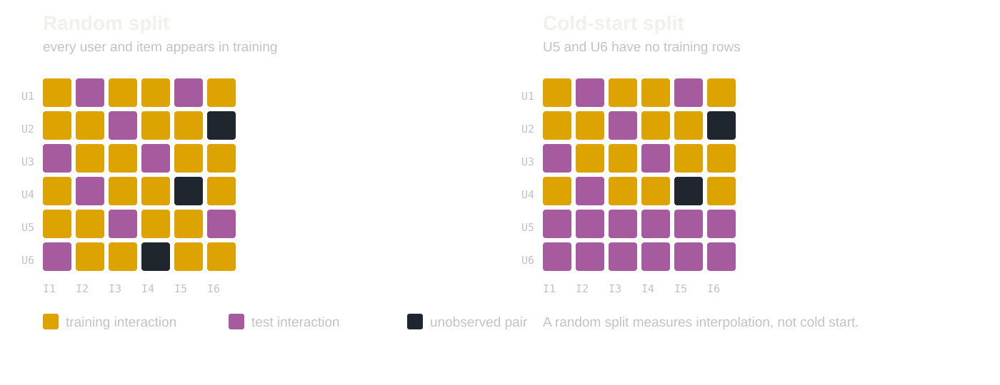
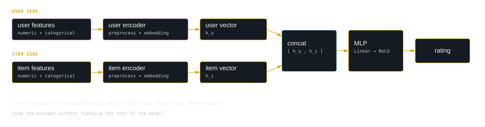
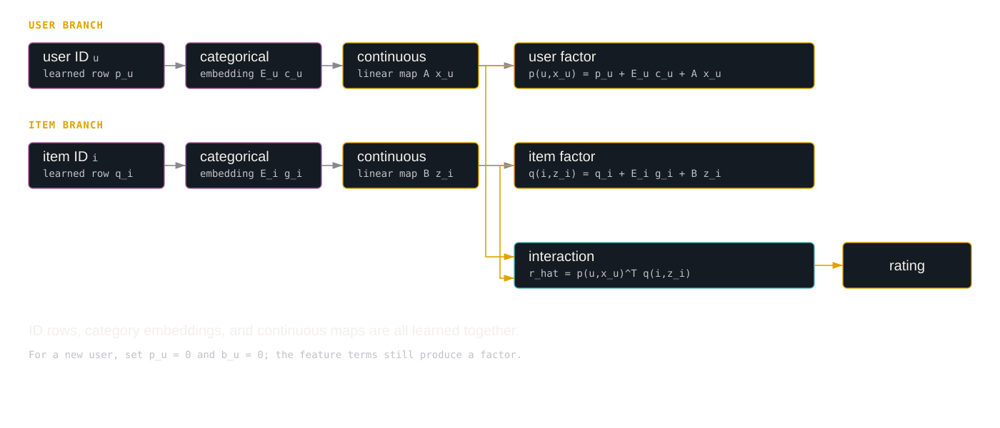
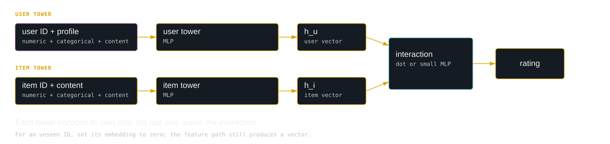
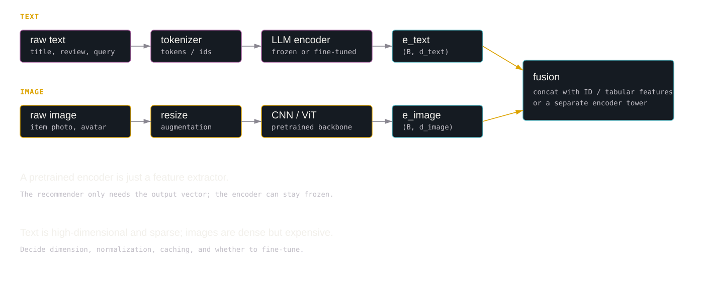

## The ID-only limit {.lesson-slide}

<div class="lesson-formula">$$\widehat r_{ui}=\mu+a_u+b_i+p_u^\top q_i$$</div>

<div class="lesson-grid">
<div class="lesson-card"><span>WARM START</span><b>Known user and item</b><p>Both ID rows were learned from training interactions. The dot product has something to look up.</p></div>
<div class="lesson-card"><span>COLD START</span><b>New user or item</b><p>No fitted row exists for that ID. The model has no personal parameter to use.</p></div>
</div>

<p class="lesson-takeaway">A new ID is not a missing rating. It is a missing <b>representation</b>.</p>

::: {.notes}
[Teaching] Start from the MF model students already know. The key distinction is “new pair of known IDs” versus “new ID entirely”. Only the second is cold start.
:::

## Cold start is not an edge case {.lesson-slide}

<div class="stat-row">
<div><b>74</b><span>test users absent from the Netflix training split</span></div>
<div><b>584</b><span>test movies absent from the Netflix training split</span></div>
<div><b>1,002</b><span>test rows with at least one unseen ID</span></div>
</div>

<table class="lesson-table side-table"><thead><tr><th>test case</th><th>what training provides</th><th>what the model can do</th></tr></thead><tbody>
<tr><td>Known IDs, new pair</td><td>history for both IDs</td><td>use learned user and item information</td></tr>
<tr><td>New user</td><td>no history for this user</td><td>fallback or use user-side features</td></tr>
<tr><td>New movie</td><td>no ratings for this movie</td><td>fallback or use item-side features</td></tr>
</tbody></table>

<p class="lesson-takeaway">A random rating split hides cold start. The important test is whether the <b>ID itself</b> was seen during training.</p>

::: {.notes}
Numbers computed from `dataset/netflix/train.csv` and `test.csv`; the same numbers appear in the course overview. This is why the lecture needs a cold-start split, not just a random holdout.
:::

## A concrete side-information table {.lesson-slide}

<table class="lesson-table side-table"><thead><tr><th>user</th><th>preference</th><th>dish</th><th>price</th><th>category</th><th>flags</th><th>rating</th></tr></thead><tbody>
<tr><td>17</td><td>Noodles</td><td>米線</td><td>42</td><td>Noodles</td><td>spicy=0, fried=0, healthy=0</td><td>4.5</td></tr>
<tr><td>17</td><td>Noodles</td><td>三餸飯</td><td>35</td><td>Rice</td><td>spicy=0, fried=0, healthy=0</td><td>3.0</td></tr>
<tr><td>42</td><td>Vegetarian &amp; lighter</td><td>野菜飯</td><td>38</td><td>Vegetarian</td><td>spicy=0, fried=0, healthy=1</td><td>5.0</td></tr>
<tr><td>42</td><td>Vegetarian &amp; lighter</td><td>炸雞翼</td><td>28</td><td>Snacks</td><td>spicy=0, fried=1, healthy=0</td><td>2.0</td></tr>
</tbody></table>

<div class="lesson-grid three">
<div class="lesson-card"><span>USER SIDE</span><b>$x_u$</b><p>Food preference, age group, stated interests.</p></div>
<div class="lesson-card"><span>ITEM SIDE</span><b>$z_i$</b><p>Price, category, genre, flags, description.</p></div>
<div class="lesson-card"><span>CONTEXT</span><b>$c_{ui}$</b><p>Time, device, location — only if available at prediction time.</p></div>
</div>

<p class="lesson-takeaway">The useful features are available <b>before</b> the rating exists.</p>

## Random split vs cold-start split {.lesson-slide}



<p class="lesson-takeaway">A random split measures interpolation. Only a cold-start split measures extrapolation. Report <b>warm</b> and <b>cold</b> metrics separately.</p>

## The whole lecture in one picture {.lesson-slide}

<div class="encoder-grid">
<div><span>1 · REQUIRED</span><b>Continuous</b><p>Already a vector. Preprocess, then fuse.</p></div>
<div><span>2 · REQUIRED</span><b>Categorical</b><p>Encode, then learn an embedding table.</p></div>
<div><span>3 · OPTIONAL</span><b>Text</b><p>LLM encoder produces a dense vector.</p></div>
<div><span>4 · OPTIONAL</span><b>Image</b><p>CNN or ViT produces a dense vector.</p></div>
</div>

<div class="lesson-flow"><div>encode<br><b>raw feature → vector</b></div><i>→</i><div>fuse<br><b>early concat or two towers</b></div><i>→</i><div>evaluate<br><b>warm and cold, without leakage</b></div></div>

<p class="lesson-takeaway">The encoder changes with the modality. The <b>fusion</b> and <b>evaluation</b> questions do not.</p>

## Part 1 · Continuous features {.section-break}

<p>Already vectors — the work is preprocessing and fusion.</p>

## A continuous feature is already a vector {.lesson-slide}

<div class="lesson-formula compact">$$x_u\in\mathbb R^{d_u},\qquad z_i\in\mathbb R^{d_i}$$</div>

<table class="lesson-table side-table"><thead><tr><th>feature</th><th>raw value</th><th>after preprocessing</th></tr></thead><tbody>
<tr><td>price</td><td>42.0 HKD</td><td>standardized scalar</td></tr>
<tr><td>spicy / fried / healthy</td><td>0 or 1</td><td>three binary columns</td></tr>
<tr><td>age</td><td>21</td><td>scaled scalar or age-bin embedding</td></tr>
<tr><td>rating count</td><td>137</td><td>log count, computed inside the fold</td></tr>
</tbody></table>

<div class="lesson-grid three">
<div class="lesson-card"><span>USER</span><b>profile and behaviour</b><p>Age, signup tenure, activity, stated preferences.</p></div>
<div class="lesson-card"><span>ITEM</span><b>content and price</b><p>Price, year, duration, flags, popularity.</p></div>
<div class="lesson-card"><span>CONTEXT</span><b>the current event</b><p>Time, device, location — if known before the prediction.</p></div>
</div>

<p class="lesson-takeaway">No embedding is needed for the raw number. But raw scale is rarely the right input.</p>

## Preprocess before you fuse {.lesson-slide}

<div class="lesson-grid four">
<div class="lesson-card"><span>MISSING</span><b>impute + indicator</b><p>Mean/median for the value; a separate “was missing” flag.</p></div>
<div class="lesson-card"><span>OUTLIERS</span><b>clip or transform</b><p>Winsorize, log-transform, or use a robust scaler.</p></div>
<div class="lesson-card"><span>SCALE</span><b>standardize</b><p>Fit the scaler on the training fold, then transform validation and test.</p></div>
<div class="lesson-card"><span>FOLD</span><b>no leakage</b><p>Every preprocessing statistic is part of the model pipeline.</p></div>
</div>

<table class="lesson-table side-table"><thead><tr><th>raw</th><th>z-score</th><th>missing flag</th></tr></thead><tbody>
<tr><td>42.0</td><td>0.08</td><td>0</td></tr>
<tr><td>—</td><td>0.00</td><td>1</td></tr>
<tr><td>89.0</td><td>4.33</td><td>0</td></tr>
</tbody></table>

<p class="lesson-takeaway">Preprocessing is not a separate notebook step. It is part of the model, and it belongs inside cross-validation.</p>

## Transform the scale, not just the column {.lesson-slide}

<table class="lesson-table side-table"><thead><tr><th>transformation</th><th>formula</th><th>what it captures</th></tr></thead><tbody>
<tr><td>standardize</td><td>$(x-\mu)/\sigma$</td><td>linear effect on a comparable scale</td></tr>
<tr><td>log</td><td>$\log(1+x)$</td><td>diminishing returns for price or counts</td></tr>
<tr><td>bin</td><td>$b(x)\in\{1,\ldots,B\}$</td><td>nonlinear step effects; bin index can be embedded</td></tr>
<tr><td>missing indicator</td><td>$\mathbf 1[x\text{ missing}]$</td><td>missingness itself may be informative</td></tr>
</tbody></table>

<div class="lesson-formula compact">$$\phi(x)=\big[\text{standardized }x,\ \log(1+x),\ \text{bin}(x),\ \text{missing flag}\big]$$</div>

<p class="lesson-takeaway">The transformation is a hyperparameter. Choose it on validation, not by looking at the test score.</p>

## Two ways to fuse a numeric vector {.lesson-slide}

<div class="lesson-grid">
<div class="lesson-card"><span>EARLY CONCAT</span><b>one wide vector</b><p>$$z=[p_u,q_i,x_u,z_i]$$</p><p>The MLP sees all features at once. Flexible, but the ID rows still dominate when they exist.</p></div>
<div class="lesson-card"><span>ADDITIVE MAP</span><b>modify the factor</b><p>$$p(u,x_u)=p_u+A x_u$$</p><p>The feature contribution is a learned linear map into the same latent space.</p></div>
</div>

<table class="lesson-table side-table"><thead><tr><th>fusion</th><th>strength</th><th>risk</th></tr></thead><tbody>
<tr><td>early concat</td><td>learns arbitrary interactions</td><td>can overfit; hard to interpret</td></tr>
<tr><td>additive map</td><td>interpretable, regularized</td><td>only linear feature effects</td></tr>
</tbody></table>

<p class="lesson-takeaway">Start with the additive map; use concat when you have enough data to learn interactions.</p>

## Continuous features in a two-tower model {.lesson-slide}

<div class="lesson-flow tight"><div>user continuous<br><b>$x_u$</b></div><i>→</i><div>user tower<br><b>$F_u(u,x_u)$</b></div><i>→</i><div>user vector<br><b>$h_u$</b></div></div>

<div class="lesson-flow tight"><div>item continuous<br><b>$z_i$</b></div><i>→</i><div>item tower<br><b>$F_i(i,z_i)$</b></div><i>→</i><div>item vector<br><b>$h_i$</b></div></div>

<div class="lesson-formula compact">$$\widehat r_{ui}=\rho(h_u,h_i)$$</div>

<p class="lesson-takeaway">Numeric features can enter either tower. Keep user and item encoders separate until the final interaction.</p>

## Numeric interactions: explicit or learned {.lesson-slide}

<div class="lesson-grid">
<div class="lesson-card"><span>EXPLICIT CROSS</span><b>engineer the product</b><p>Add terms such as “user price × item price” or a small set of domain-specific crosses.</p></div>
<div class="lesson-card"><span>LEARNED CROSS</span><b>let the MLP learn it</b><p>Concatenate the numeric vectors and let the hidden layers approximate the interaction.</p></div>
</div>

<div class="lesson-formula compact">$$x_u\otimes z_i=\{x_{uj}z_{ik}\}_{j,k}$$</div>

<p class="lesson-takeaway">Explicit crosses encode domain knowledge. Learned crosses need more data. Do not add every product blindly.</p>

## Rating-derived features leak {.lesson-slide}

<table class="lesson-table side-table"><thead><tr><th>feature</th><th>computed globally</th><th>computed inside the fold</th><th>available for a new ID?</th></tr></thead><tbody>
<tr><td>user rating mean</td><td>uses held-out ratings</td><td>uses fitting rows only</td><td>no</td></tr>
<tr><td>item rating count</td><td>uses held-out ratings</td><td>uses fitting rows only</td><td>no</td></tr>
<tr><td>rating quantile</td><td>uses held-out ratings</td><td>uses fitting rows only</td><td>no</td></tr>
</tbody></table>

<div class="lesson-grid">
<div class="lesson-card"><span>SAFE</span><b>profile or content</b><p>Food preference, price, category, description — available before the rating.</p></div>
<div class="lesson-card"><span>LEAKY</span><b>rating summary</b><p>Mean, count, quantile — computed from ratings, and unavailable for a genuinely new ID.</p></div>
</div>

<p class="lesson-takeaway">If a feature is computed from the target, it must be computed inside the fitting fold. If it needs ratings, it cannot solve cold start.</p>

## Part 2 · Categorical features {.section-break}

<p>A category is an ID. An embedding is a learned lookup table.</p>

## A category is an ID {.lesson-slide}

<table class="lesson-table side-table"><thead><tr><th>category</th><th>encoded index</th><th>one-hot</th><th>learned vector</th></tr></thead><tbody>
<tr><td>Noodles</td><td>0</td><td>[1,0,0,0,0,0]</td><td>$e_0$</td></tr>
<tr><td>Rice</td><td>1</td><td>[0,1,0,0,0,0]</td><td>$e_1$</td></tr>
<tr><td>Vegetarian</td><td>2</td><td>[0,0,1,0,0,0]</td><td>$e_2$</td></tr>
</tbody></table>

<div class="lesson-formula compact">$$j\;\longrightarrow\;\mathbf e_j\in\mathbb R^K$$</div>

<p class="lesson-takeaway">The only difference from a user ID is the name of the column. Both select rows from a learned table.</p>

## The embedding layer is a lookup {.lesson-slide}

```python
genre = nn.Embedding(num_embeddings=8, embedding_dim=16)
j = torch.tensor([1, 3])       # (B,)
e = genre(j)                    # (B,16)
print(e.shape)                  # torch.Size([2, 16])
```

<div class="lesson-formula compact">$$\mathbf e_j=\text{onehot}(j)^\top E,\qquad E\in\mathbb R^{J\times K}$$</div>

<table class="lesson-table side-table"><thead><tr><th>input shape</th><th>output shape</th><th>example</th></tr></thead><tbody>
<tr><td>$(B,)$</td><td>$(B,K)$</td><td>one category per row</td></tr>
<tr><td>$(B,T)$</td><td>$(B,T,K)$</td><td>a sequence of categories or tokens</td></tr>
</tbody></table>

<p class="lesson-takeaway">The forward pass only selects rows. Gradients update the rows that were used.</p>

## Choosing the embedding size {.lesson-slide}

<div class="lesson-formula compact">$$\text{parameters}=J\times K$$</div>

<table class="lesson-table side-table"><thead><tr><th>categorical field</th><th>$J$</th><th>$K$</th><th>parameters</th></tr></thead><tbody>
<tr><td>food preference</td><td>6</td><td>4</td><td>24</td></tr>
<tr><td>dish category</td><td>8</td><td>8</td><td>64</td></tr>
<tr><td>dish ID</td><td>183</td><td>16</td><td>2,928</td></tr>
<tr><td>movie ID</td><td>3,568</td><td>16</td><td>57,088</td></tr>
</tbody></table>

<div class="lesson-grid">
<div class="lesson-card"><span>SMALL $J$</span><b>4–8</b><p>Food preference, gender, small category sets.</p></div>
<div class="lesson-card"><span>LARGE $J$</span><b>8–32</b><p>Item IDs, occupations, zip codes; watch the parameter count.</p></div>
</div>

<p class="lesson-takeaway">$K$ is a hyperparameter. Too large overfits sparse categories; too small cannot separate them.</p>

## Multi-valued categories {.lesson-slide}

<div class="lesson-formula compact">$$\mathbf e(g_i)=\sum_{j\in g_i}\mathbf e_j\quad\text{or}\quad\frac{1}{|g_i|}\sum_{j\in g_i}\mathbf e_j$$</div>

<table class="lesson-table side-table"><thead><tr><th>item</th><th>genre set</th><th>representation</th></tr></thead><tbody>
<tr><td>Toy Story</td><td>{Adventure, Animation, Children, Comedy}</td><td>sum of four embeddings</td></tr>
<tr><td>Jumanji</td><td>{Adventure, Children, Fantasy}</td><td>sum of three embeddings</td></tr>
</tbody></table>

<div class="lesson-grid three">
<div class="lesson-card"><span>SUM</span><b>preserves multiplicity</b><p>More genres contribute more signal.</p></div>
<div class="lesson-card"><span>MEAN</span><b>normalizes count</b><p>Comparable scale across items with different numbers of tags.</p></div>
<div class="lesson-card"><span>ATTENTION</span><b>learns weights</b><p>Useful when some tags matter more than others.</p></div>
</div>

<p class="lesson-takeaway">A multi-hot linear model with shared weights is exactly a sum of embeddings.</p>

## High-cardinality categories {.lesson-slide}

<table class="lesson-table side-table"><thead><tr><th>problem</th><th>technique</th><th>what it does</th></tr></thead><tbody>
<tr><td>millions of categories</td><td>hashing</td><td>map many values into a fixed number of buckets</td></tr>
<tr><td>rare categories</td><td>frequency threshold</td><td>send rare values to an “other” bucket</td></tr>
<tr><td>long tail</td><td>count bucket</td><td>keep the count, not the exact identity</td></tr>
<tr><td>target-dependent</td><td>out-of-fold target encoding</td><td>compute only on fitting rows; risky, use with care</td></tr>
</tbody></table>

<div class="lesson-grid">
<div class="lesson-card"><span>WHY IT MATTERS</span><b>parameter blow-up</b><p>A table with $10^6$ rows and $K=32$ has 32 million parameters.</p></div>
<div class="lesson-card"><span>DEFAULT</span><b>hashing + rare bucket</b><p>Cheap, robust, and easy to deploy online.</p></div>
</div>

<p class="lesson-takeaway">High cardinality is a memory and overfitting problem, not just an encoding problem.</p>

## Unseen categories need a policy {.lesson-slide}

<table class="lesson-table side-table"><thead><tr><th>policy</th><th>new category</th><th>trade-off</th></tr></thead><tbody>
<tr><td>unknown token</td><td>one shared “unknown” embedding</td><td>simple; loses distinction between new values</td></tr>
<tr><td>zero vector</td><td>no contribution</td><td>safe fallback; the model ignores the field</td></tr>
<tr><td>parent category</td><td>fall back to a coarser level</td><td>requires a hierarchy</td></tr>
<tr><td>feature fallback</td><td>use description or price</td><td>needs another available feature</td></tr>
</tbody></table>

<div class="lesson-formula compact">$$\text{new category}\;\longrightarrow\;\mathbf e_{\text{unk}}\quad\text{or}\quad\mathbf 0$$</div>

<p class="lesson-takeaway">Decide the unknown-category policy before deployment. A crash at serving time is not a modelling choice.</p>

## Feature crossing {.lesson-slide}

<div class="lesson-formula compact">$$x_u\otimes z_i=\{x_{uj}z_{ik}\}_{j,k}$$</div>

<div class="lesson-grid three">
<div class="lesson-card"><span>EXPLICIT</span><b>domain crosses</b><p>Food preference × category, price × healthy — chosen by the analyst.</p></div>
<div class="lesson-card"><span>HASHED</span><b>many crosses</b><p>Hash the crossed index into a fixed table; cheap but opaque.</p></div>
<div class="lesson-card"><span>LEARNED</span><b>MLP or DeepFM</b><p>Let the network learn the interaction from raw features.</p></div>
</div>

<p class="lesson-takeaway">A crossing is a new categorical feature. Treat it with the same encoding, cardinality, and leakage rules.</p>

## Continuous + categorical fusion {.lesson-slide}



<p class="lesson-takeaway">The recommender only sees vectors. Swapping an encoder should not change the fusion block.</p>

## Part 3 · Fusion architectures {.section-break}

<p>Same encoders, different interaction.</p>

## Three ways to use side information {.lesson-slide}

<div class="lesson-grid three">
<div class="lesson-card"><span>FEATURES ONLY</span><b>$f(x_u,z_i)$</b><p>Handles new IDs, but may miss individual preferences.</p></div>
<div class="lesson-card"><span>ADD TO MF</span><b>$p_u^\top q_i+f(x_u,z_i)$</b><p>Keeps personalized ID factors and adds a feature contribution.</p></div>
<div class="lesson-card"><span>SIDE-AWARE FACTORS</span><b>$p(u,x_u)^\top q(i,z_i)$</b><p>Builds each factor from ID and features together.</p></div>
</div>

<p class="lesson-takeaway">The third approach makes the interaction depend on the features on <b>both</b> sides.</p>

## Feature-only baseline {.lesson-slide}

<div class="lesson-formula">$$\widehat r_{ui}=f_\theta(x_u,z_i)$$</div>

<table class="lesson-table side-table"><thead><tr><th>advantage</th><th>limitation</th></tr></thead><tbody>
<tr><td>works for a completely new user or item</td><td>no individual ID preference</td></tr>
<tr><td>no huge ID tables</td><td>may underfit users with long histories</td></tr>
<tr><td>easy to deploy for new content</td><td>feature quality becomes the bottleneck</td></tr>
</tbody></table>

<p class="lesson-takeaway">Always fit this baseline. If it beats MF on warm users, the side features are unusually strong.</p>

## Additive MF {.lesson-slide}

<div class="lesson-formula compact">$$\widehat r_{ui}=\mu+a_u+b_i+p_u^\top q_i+f_\theta(x_u,z_i)$$</div>

<div class="lesson-grid">
<div class="lesson-card"><span>MF PATH</span><b>personalization</b><p>$p_u^\top q_i$ keeps the user–item interaction learned from the rating matrix.</p></div>
<div class="lesson-card"><span>FEATURE PATH</span><b>generalization</b><p>$f_\theta(x_u,z_i)$ adds a signal that is available for new IDs.</p></div>
</div>

<p class="lesson-takeaway">This is a safe first model: it keeps the familiar MF result and adds features as a correction.</p>

## Side-aware factors {.lesson-slide}

<div class="lesson-formula compact">$$p(u,x_u)=p_u+A x_u+e_{c(u)},\qquad q(i,z_i)=q_i+B z_i+e_{g(i)}$$</div>

<div class="lesson-formula compact">$$\widehat r_{ui}=p(u,x_u)^\top q(i,z_i)$$</div>

<div class="lesson-grid">
<div class="lesson-card"><span>USER VECTOR</span><b>ID + numeric + category</b><p>$p_u$ is personalized; $A x_u$ and $e_{c(u)}$ bring in user features.</p></div>
<div class="lesson-card"><span>ITEM VECTOR</span><b>ID + numeric + category</b><p>$q_i$ is item-specific; $B z_i$ and $e_{g(i)}$ bring in item features.</p></div>
</div>

<p class="lesson-takeaway">Features modify the factors themselves, not only the final score.</p>

## Features as a prior, ID as a residual {.lesson-slide}

<div class="lesson-formula">$$p_u=f_\theta(x_u)+e_u,\qquad q_i=g_\phi(z_i)+d_i$$</div>

<div class="lesson-grid three">
<div class="lesson-card"><span>POPULATION</span><b>feature map</b><p>$f_\theta(x_u)$ predicts the average taste of users with this profile.</p></div>
<div class="lesson-card"><span>INDIVIDUAL</span><b>ID residual</b><p>$e_u$ captures what the features miss about this specific user.</p></div>
<div class="lesson-card"><span>NEW USER</span><b>$e_u=0$</b><p>The feature map becomes the prior; the residual is unavailable.</p></div>
</div>

<p class="lesson-takeaway">This is the mixed-effects view of side information: features explain the population, IDs explain the deviation.</p>

::: {.notes}
[Teaching] This slide is the statistical heart of the lecture. The model is not “IDs versus features”; it is a decomposition into a feature-based prior and an ID-specific residual. Regularization shrinks the residual toward zero.
:::

## The linear side-aware model as a network {.lesson-slide}



<p class="lesson-takeaway">Every box is differentiable. One optimizer learns the ID rows, the category tables, and the feature maps together.</p>

## Two-tower architecture {.lesson-slide}



<p class="lesson-takeaway">Each tower learns nonlinear interactions <b>within</b> its side; the final layer learns the interaction <b>across</b> sides.</p>

## Shape contract and parameter count {.lesson-slide}

<table class="lesson-table side-table"><thead><tr><th>step</th><th>input</th><th>operation</th><th>output</th></tr></thead><tbody>
<tr><td>user ID</td><td>$(B,)$</td><td>embedding lookup</td><td>$(B,K)$</td></tr>
<tr><td>item ID</td><td>$(B,)$</td><td>embedding lookup</td><td>$(B,K)$</td></tr>
<tr><td>categories</td><td>$(B,)$ each</td><td>embedding lookup</td><td>$(B,K_c)$ each</td></tr>
<tr><td>continuous</td><td>$(B,d)$</td><td>identity or linear map</td><td>$(B,d)$ or $(B,K)$</td></tr>
<tr><td>fusion</td><td>all vectors</td><td><code>torch.cat</code></td><td>$(B,D)$</td></tr>
<tr><td>head</td><td>$(B,D)$</td><td>MLP</td><td>$(B,1)$</td></tr>
</tbody></table>

<p class="lesson-takeaway">Print every intermediate shape once. Most side-information bugs are shape or dtype bugs.</p>

## Dot product, MLP, or bilinear? {.lesson-slide}

<div class="lesson-grid three">
<div class="lesson-card"><span>DOT</span><b>$h_u^\top h_i$</b><p>Cheap, retrieval-friendly, interpretable as matching.</p></div>
<div class="lesson-card"><span>MLP</span><b>$\rho([h_u,h_i])$</b><p>More flexible; can learn non-matching interactions.</p></div>
<div class="lesson-card"><span>BILINEAR</span><b>$h_u^\top W h_i$</b><p>A low-rank interaction matrix; a middle ground.</p></div>
</div>

<table class="lesson-table side-table"><thead><tr><th>choice</th><th>use when</th></tr></thead><tbody>
<tr><td>dot product</td><td>large catalogue, retrieval, low latency</td></tr>
<tr><td>MLP</td><td>small catalogue, rich features, ranking</td></tr>
<tr><td>bilinear</td><td>you want learned interactions with fewer parameters</td></tr>
</tbody></table>

<p class="lesson-takeaway">The interaction is a model choice, not a fixed part of “two-tower”.</p>

## Cold-start fallback policies {.lesson-slide}

<table class="lesson-table side-table"><thead><tr><th>policy</th><th>known ID</th><th>new ID</th><th>risk</th></tr></thead><tbody>
<tr><td>zero embedding</td><td>learned row</td><td>zero vector</td><td>feature signal may be too weak</td></tr>
<tr><td>feature-only</td><td>ignore ID</td><td>feature vector</td><td>loses personalization for warm users</td></tr>
<tr><td>global mean</td><td>model score</td><td>training mean</td><td>safe but not personalized</td></tr>
<tr><td>nearest neighbour</td><td>model score</td><td>average of similar feature profiles</td><td>needs a good feature distance</td></tr>
</tbody></table>

<p class="lesson-takeaway">The fallback is part of the model. Evaluate it on the cold segment, not on the overall average.</p>

## Part 4 · Train, evaluate, diagnose {.section-break}

<p>The model is only as good as the split.</p>

## Four questions for the side-aware model {.lesson-slide}

<div class="lesson-grid four">
<div class="lesson-card"><span>1 · MODEL</span><b>factors from IDs + features</b><p>Predict with $p(u,x_u)^\top q(i,z_i)$.</p></div>
<div class="lesson-card"><span>2 · HYPERPARAMETERS</span><b>$K$, hidden width, $\lambda$</b><p>Choose before fitting; tune on validation.</p></div>
<div class="lesson-card"><span>3 · CRITERION</span><b>rating error + penalty</b><p>Minimize errors on training pairs, with complexity control.</p></div>
<div class="lesson-card"><span>4 · LEARNED</span><b>embeddings + maps</b><p>ID/category tables and feature maps $A,B$.</p></div>
</div>

<div class="lesson-formula compact">$$\mathcal L(\theta)=\frac1{|\Omega|}\sum_{(u,i)\in\Omega}(r_{ui}-\widehat r_{ui})^2+\lambda\,\mathrm{Reg}(\theta)$$</div>

<p class="lesson-takeaway">The four questions do not change when the model gets bigger.</p>

## Loss and regularization {.lesson-slide}

<div class="lesson-formula">$$\mathcal L=\frac1{|\Omega|}\sum_{(u,i)\in\Omega}(r_{ui}-\widehat r_{ui})^2+\lambda_1\|E\|_2^2+\lambda_2\|W\|_2^2$$</div>

<div class="lesson-grid three">
<div class="lesson-card"><span>MSE</span><b>rating error</b><p>Matches the RMSE evaluation and the 1–5 star target.</p></div>
<div class="lesson-card"><span>WEIGHT DECAY</span><b>shrink maps</b><p>Controls the flexibility of the feature-to-factor maps.</p></div>
<div class="lesson-card"><span>EMBEDDING NORM</span><b>shrink tables</b><p>Useful for rare IDs and rare categories.</p></div>
</div>

<p class="lesson-takeaway">One loss trains the ID tables, the category tables, and the feature maps. There is no separate “side-information loss”.</p>

## One optimizer, three training modes {.lesson-slide}

<table class="lesson-table side-table"><thead><tr><th>mode</th><th>trainable parameters</th><th>when</th></tr></thead><tbody>
<tr><td>from scratch</td><td>everything</td><td>tabular features, enough data</td></tr>
<tr><td>frozen encoder</td><td>fusion layers only</td><td>LLM or CNN features, small data, limited compute</td></tr>
<tr><td>partial fine-tune</td><td>last encoder block + fusion</td><td>moderate data, domain shift, enough compute</td></tr>
</tbody></table>

<div class="lesson-grid">
<div class="lesson-card"><span>FROZEN</span><b>cheap and stable</b><p>Precompute vectors once; train a small head. The recommender never backpropagates into the encoder.</p></div>
<div class="lesson-card"><span>FINE-TUNED</span><b>expressive but risky</b><p>Can adapt to the domain, but overfits small data and increases serving cost.</p></div>
</div>

<p class="lesson-takeaway">Decide what is learned before you write the optimizer. The parameter groups are part of the model design.</p>

## A PyTorch implementation sketch {.lesson-slide .lesson-code .side-code-sm}

```python
class SideNCF(nn.Module):
    def __init__(self, n_users, n_items, n_ucat, n_icat,
                 d_u, d_i, K=16, Kc=8, hidden=64):
        super().__init__()
        self.user_emb = nn.Embedding(n_users, K)
        self.item_emb = nn.Embedding(n_items, K)
        self.user_cat = nn.Embedding(n_ucat, Kc)
        self.item_cat = nn.Embedding(n_icat, Kc)
        self.net = nn.Sequential(
            nn.Linear(2 * K + 2 * Kc + d_u + d_i, hidden),
            nn.ReLU(),
            nn.Linear(hidden, 1),
        )

    def forward(self, u, i, uc, ic, xu, zi):
        z = torch.cat([
            self.user_emb(u), self.item_emb(i),
            self.user_cat(uc), self.item_cat(ic),
            xu, zi,
        ], dim=1)
        return self.net(z)
```

<p class="lesson-takeaway">This is the whole “continuous + categorical” fusion: three lookups, two numeric blocks, one <code>torch.cat</code>, one MLP.</p>

## Warm start and cold start are different tests {.lesson-slide}

<table class="lesson-table side-table"><thead><tr><th>split</th><th>training sees</th><th>test asks</th><th>what it measures</th></tr></thead><tbody>
<tr><td>random rows</td><td>every user and item</td><td>new pairs of known IDs</td><td>interpolation</td></tr>
<tr><td>cold users</td><td>80% of users</td><td>20% unseen users</td><td>user-side generalization</td></tr>
<tr><td>cold items</td><td>80% of items</td><td>20% unseen items</td><td>item-side generalization</td></tr>
</tbody></table>

<div class="lesson-grid">
<div class="lesson-card"><span>REPORT</span><b>warm and cold separately</b><p>One aggregate RMSE can hide a cold segment that is no better than the global mean.</p></div>
<div class="lesson-card"><span>COMPARE</span><b>same split, same features</b><p>Change one thing: features, fusion, or encoder. Do not change the split.</p></div>
</div>

<p class="lesson-takeaway">A model that wins on a random split is not necessarily a model that solves cold start.</p>

## Leakage-safe cross-validation {.lesson-slide}

<div class="lesson-flow tight"><div>split rows<br><b>train / validation</b></div><i>→</i><div>fit encoders<br><b>scalers, category maps</b></div><i>→</i><div>transform<br><b>validation rows</b></div><i>→</i><div>fit model<br><b>and score</b></div></div>

<table class="lesson-table side-table"><thead><tr><th>step</th><th>safe</th><th>leaky</th></tr></thead><tbody>
<tr><td>scaling</td><td>fit on training fold</td><td>fit on all rows</td></tr>
<tr><td>category encoding</td><td>fit on training fold</td><td>use test categories to build the vocabulary</td></tr>
<tr><td>rating summaries</td><td>out-of-fold only</td><td>use the held-out rating</td></tr>
<tr><td>text/image encoder</td><td>pretrained on external data</td><td>fine-tune on the test labels</td></tr>
</tbody></table>

<p class="lesson-takeaway">For each fold: split first → learn encodings and summaries on fitting rows → transform held-out rows → score.</p>

## Baselines and ablation {.lesson-slide}

<p class="lesson-lede">Canteen data, 20% of users held out entirely. Synthetic ratings; compare models, not absolute values.</p>

<table class="lesson-table side-table"><thead><tr><th>model</th><th>features used</th><th>warm RMSE</th><th>cold-user RMSE</th></tr></thead><tbody>
<tr><td>global mean</td><td>none</td><td>0.913</td><td>0.911</td></tr>
<tr><td>feature-only ridge</td><td>continuous + categorical</td><td>—</td><td>0.756</td></tr>
<tr><td>ID-only MF</td><td>IDs only</td><td><b>0.316</b></td><td>0.910</td></tr>
<tr><td>two-tower</td><td>IDs + continuous + categorical</td><td>—</td><td><b>0.346</b></td></tr>
</tbody></table>

<p class="lesson-takeaway">MF is excellent when IDs exist and useless when they do not. Side-aware models close most of the cold-start gap.</p>

::: {.notes}
[Source] Quick sanity check on `dataset/cuhk-food`. The data are synthetic and have a strong latent group structure, so the absolute RMSE is optimistic. The relative pattern is the teaching point: warm MF is strong; cold MF collapses; feature-only helps; a learned interaction helps much more.
:::

## What the results mean {.lesson-slide}

<div class="lesson-grid three">
<div class="lesson-card"><span>WARM</span><b>IDs dominate</b><p>When a user has history, the ID residual carries a lot of signal. Features may add only a small amount.</p></div>
<div class="lesson-card"><span>COLD USER</span><b>features carry the model</b><p>The ID row is zero; the user tower must build a representation from the profile.</p></div>
<div class="lesson-card"><span>COLD ITEM</span><b>content carries the model</b><p>The item tower must build a representation from category, price, text, or image.</p></div>
</div>

<table class="lesson-table side-table"><thead><tr><th>question</th><th>what to inspect</th></tr></thead><tbody>
<tr><td>Did side info help?</td><td>cold RMSE vs global mean and feature-only baseline</td></tr>
<tr><td>Did the interaction help?</td><td>two-tower vs additive feature model</td></tr>
<tr><td>Did the encoder help?</td><td>with/without text or image, frozen vs fine-tuned</td></tr>
</tbody></table>

<p class="lesson-takeaway">Always report the segment where the model is supposed to help.</p>

## Common failure patterns {.lesson-slide}

<table class="lesson-table side-table"><thead><tr><th>symptom</th><th>likely cause</th><th>next check</th></tr></thead><tbody>
<tr><td>cold RMSE worse than global mean</td><td>feature pipeline mismatch or leakage</td><td>compare train/serve feature distributions</td></tr>
<tr><td>unseen category crashes</td><td>no unknown token</td><td>audit the encoder vocabulary</td></tr>
<tr><td>ID embedding dominates</td><td>features are too weak or too late</td><td>remove IDs and compare cold RMSE</td></tr>
<tr><td>text model overfits</td><td>fine-tuned encoder on small data</td><td>freeze the encoder; add a projection</td></tr>
<tr><td>validation great, test poor</td><td>leakage or a lucky split</td><td>audit every feature's timestamp</td></tr>
<tr><td>huge parameter count</td><td>high-cardinality embeddings</td><td>hash, bucket, or reduce $K$</td></tr>
</tbody></table>

<p class="lesson-takeaway">Most side-information failures are data-pipeline failures, not architecture failures.</p>

## Part 5 · Text side information {.section-break}

<p><span class="optional-badge">Optional</span> Same fusion, different encoder.</p>

## Text is a high-dimensional side feature {.lesson-slide}

<div class="lesson-grid four">
<div class="lesson-card"><span>ITEM</span><b>title</b><p>Short but informative; cheap to embed.</p></div>
<div class="lesson-card"><span>ITEM</span><b>description</b><p>Longer content; may contain genre, style, or quality cues.</p></div>
<div class="lesson-card"><span>USER</span><b>profile</b><p>Self-description, stated interests, or a query.</p></div>
<div class="lesson-card"><span>FEEDBACK</span><b>review</b><p>Rich but risky: the review may mention the rating.</p></div>
</div>

<div class="lesson-formula compact">$$\text{text}\;\longrightarrow\;\mathbf e_{\text{text}}\in\mathbb R^{d}$$</div>

<p class="lesson-takeaway">Text can describe an entity before it has any interactions — exactly what cold start needs.</p>

## From text to vector {.lesson-slide}

<table class="lesson-table side-table"><thead><tr><th>method</th><th>dimension</th><th>strength</th><th>limitation</th></tr></thead><tbody>
<tr><td>TF-IDF + SVD</td><td>50–300</td><td>fast, interpretable, no GPU</td><td>no word order or semantics</td></tr>
<tr><td>word2vec / GloVe</td><td>100–300</td><td>pretrained semantics</td><td>one vector per word; pooling loses structure</td></tr>
<tr><td>LLM sentence embedding</td><td>384–4096</td><td>strong semantics, multilingual</td><td>cost, latency, versioning, dimension</td></tr>
</tbody></table>

<div class="lesson-flow tight"><div>raw text</div><i>→</i><div>tokenize</div><i>→</i><div>encoder</div><i>→</i><div>pool / normalize</div><i>→</i><div>e_text</div></div>

<p class="lesson-takeaway">An LLM embedding is not magic. It is a high-quality encoder that turns text into a vector the recommender can use.</p>

## Frozen or fine-tuned? {.lesson-slide}

<table class="lesson-table side-table"><thead><tr><th>strategy</th><th>data needed</th><th>compute</th><th>latency</th></tr></thead><tbody>
<tr><td>frozen encoder</td><td>small</td><td>low</td><td>precompute once</td></tr>
<tr><td>last layer / adapter</td><td>medium</td><td>medium</td><td>moderate</td></tr>
<tr><td>full fine-tune</td><td>large</td><td>high</td><td>high</td></tr>
</tbody></table>

<div class="lesson-grid">
<div class="lesson-card"><span>START FROZEN</span><b>baseline first</b><p>Precompute embeddings, train a projection and the recommender head. This is cheap and reproducible.</p></div>
<div class="lesson-card"><span>FINE-TUNE LATER</span><b>only with evidence</b><p>Fine-tune when the domain is specialized and the frozen embedding clearly underperforms.</p></div>
</div>

<p class="lesson-takeaway">The encoder is a modeling choice with a cost. “Use an LLM” is not a complete architecture.</p>

## Fuse text without drowning the model {.lesson-slide}

<div class="lesson-formula compact">$$\mathbf e_{\text{text}}=E_{\text{LLM}}(\text{text}),\qquad \mathbf z_{\text{text}}=W\mathbf e_{\text{text}}\in\mathbb R^{K}$$</div>

<div class="lesson-grid three">
<div class="lesson-card"><span>PROJECT</span><b>match the width</b><p>Map 768 or 1024 dimensions down to the recommender's embedding size.</p></div>
<div class="lesson-card"><span>NORMALIZE</span><b>comparable scale</b><p>L2-normalize or standardize before concatenation.</p></div>
<div class="lesson-card"><span>FUSE</span><b>concat or tower</b><p>Early concat for ranking; item tower for retrieval and cold items.</p></div>
</div>



<p class="lesson-takeaway">Text is high-dimensional. Project it before it competes with the ID embedding.</p>

## Does text actually help? {.lesson-slide}

<table class="lesson-table side-table"><thead><tr><th>comparison</th><th>what it answers</th></tr></thead><tbody>
<tr><td>no text vs frozen text</td><td>is the text signal useful at all?</td></tr>
<tr><td>frozen vs fine-tuned</td><td>is domain adaptation worth the cost?</td></tr>
<tr><td>warm vs cold item</td><td>does text help the segment it is supposed to help?</td></tr>
<tr><td>with vs without text leakage audit</td><td>did the review mention the rating?</td></tr>
</tbody></table>

<div class="lesson-grid">
<div class="lesson-card"><span>COST</span><b>API or GPU</b><p>Embedding 1M items once is different from embedding every request.</p></div>
<div class="lesson-card"><span>RISK</span><b>leakage and drift</b><p>Reviews can reveal ratings; encoder versions can change the feature distribution.</p></div>
</div>

<p class="lesson-takeaway">Measure the text gain on the cold segment. A warm-user gain may just be extra capacity.</p>

## Part 6 · Image side information {.section-break}

<p><span class="optional-badge">Optional</span> CNN or ViT as a feature extractor.</p>

## Image is another encoder {.lesson-slide}

<div class="lesson-grid four">
<div class="lesson-card"><span>ITEM</span><b>product photo</b><p>Visual style, category, colour, quality.</p></div>
<div class="lesson-card"><span>ITEM</span><b>dish photo</b><p>Portion, ingredients, presentation.</p></div>
<div class="lesson-card"><span>USER</span><b>avatar</b><p>Weak signal, privacy-sensitive.</p></div>
<div class="lesson-card"><span>CONTEXT</span><b>screenshot</b><p>Useful in UI or app recommendation.</p></div>
</div>

<div class="lesson-formula compact">$$\text{image}\;\longrightarrow\;\mathbf e_{\text{image}}\in\mathbb R^{d}$$</div>

<p class="lesson-takeaway">An image encoder is a feature extractor. The recommender does not need to know whether the vector came from a photo or a table.</p>

## CNN or ViT? {.lesson-slide}

<table class="lesson-table side-table"><thead><tr><th>encoder</th><th>inductive bias</th><th>data need</th><th>compute</th></tr></thead><tbody>
<tr><td>ResNet</td><td>local convolution, translation</td><td>moderate</td><td>moderate</td></tr>
<tr><td>EfficientNet</td><td>scaled convolution</td><td>moderate</td><td>lower</td></tr>
<tr><td>ViT</td><td>global attention, weak locality</td><td>large</td><td>high</td></tr>
<tr><td>CLIP</td><td>image–text alignment</td><td>zero-shot / pretrained</td><td>moderate</td></tr>
</tbody></table>

<div class="lesson-grid">
<div class="lesson-card"><span>SMALL DATA</span><b>frozen ResNet</b><p>Use penultimate features; train only the fusion head.</p></div>
<div class="lesson-card"><span>ZERO-SHOT</span><b>CLIP embedding</b><p>Useful when you also have text labels or descriptions.</p></div>
</div>

<p class="lesson-takeaway">Start with a pretrained backbone and frozen features. Fine-tuning a CNN on a small rating dataset is usually a trap.</p>

## Frozen, fine-tuned, or multimodal? {.lesson-slide}

<table class="lesson-table side-table"><thead><tr><th>strategy</th><th>what changes</th><th>when</th></tr></thead><tbody>
<tr><td>frozen</td><td>fusion head only</td><td>small data, fast baseline</td></tr>
<tr><td>last block</td><td>some visual adaptation</td><td>domain shift, medium data</td></tr>
<tr><td>full fine-tune</td><td>the whole encoder</td><td>large data, compute available</td></tr>
</tbody></table>

<div class="lesson-grid three">
<div class="lesson-card"><span>EARLY</span><b>concat</b><p>Image vector joins the item features before the MLP.</p></div>
<div class="lesson-card"><span>LATE</span><b>item tower</b><p>Image encoder is one branch of the item tower.</p></div>
<div class="lesson-card"><span>ALIGN</span><b>CLIP-style</b><p>Image and text vectors share a space; useful for zero-shot items.</p></div>
</div>

<p class="lesson-takeaway">Multimodal fusion is still fusion. Decide whether the modalities meet early or in separate towers.</p>

## Image in practice {.lesson-slide}

<div class="lesson-grid four">
<div class="lesson-card"><span>COST</span><b>storage + GPU</b><p>Precompute embeddings; do not run a CNN on every request.</p></div>
<div class="lesson-card"><span>PRIVACY</span><b>user images</b><p>Avatars and screenshots need explicit handling.</p></div>
<div class="lesson-card"><span>RIGHTS</span><b>item photos</b><p>Copyright and licensing matter for production.</p></div>
<div class="lesson-card"><span>QUALITY</span><b>resolution</b><p>Thumbnails and watermarks can destroy the signal.</p></div>
</div>

<table class="lesson-table side-table"><thead><tr><th>comparison</th><th>what it answers</th></tr></thead><tbody>
<tr><td>no image vs frozen image</td><td>is there useful visual signal?</td></tr>
<tr><td>frozen vs last-block</td><td>is domain adaptation worth it?</td></tr>
<tr><td>warm vs cold item</td><td>does the image help new items?</td></tr>
</tbody></table>

<p class="lesson-takeaway">Image features are expensive and often weak on small data. Measure before adding them to the model.</p>

## Part 7 · Industry systems {.section-break}

<p>Same pattern at scale.</p>

## YouTube: retrieval and ranking {.lesson-slide}

<div class="lesson-flow tight"><div>user history<br><b>watch + search</b></div><i>+</i><div>user features<br><b>demographics, context</b></div><i>→</i><div>user tower</div></div>

<div class="lesson-flow tight"><div>item features<br><b>video metadata</b></div><i>→</i><div>item tower</div><i>→</i><div>candidate generation</div></div>

<div class="lesson-grid three">
<div class="lesson-card"><span>RETRIEVAL</span><b>millions → hundreds</b><p>Two-tower dot product, nearest-neighbour search.</p></div>
<div class="lesson-card"><span>RANKING</span><b>hundreds → top few</b><p>Richer features and a larger model; latency matters.</p></div>
<div class="lesson-card"><span>FEATURES</span><b>history is side info</b><p>Watch/search sequences represent the user before the current item.</p></div>
</div>

<p class="lesson-takeaway">The two-tower pattern is a retrieval architecture first; the same encoders can feed a ranking model later.</p>

::: {.notes}
[Source] Covington, Adams & Sargin (2016), “Deep Neural Networks for YouTube Recommendations”. The original deck has `youtube.png`; this slide is a simplified version of the same idea.
:::

## eBay: sequence plus content {.lesson-slide}

<div class="lesson-flow tight"><div>user event sequence<br><b>clicks, purchases</b></div><i>→</i><div>GRU<br><b>user embedding</b></div></div>

<div class="lesson-flow tight"><div>item title<br><b>text</b></div><i>+</i><div>aspect / category<br><b>categorical</b></div><i>→</i><div>MLP<br><b>item embedding</b></div></div>

<div class="lesson-formula compact">$$\text{affinity}=\langle h_{\text{user}},h_{\text{item}}\rangle$$</div>

<div class="lesson-grid">
<div class="lesson-card"><span>USER SIDE</span><b>behaviour sequence</b><p>Sequence models turn a variable-length history into a fixed vector.</p></div>
<div class="lesson-card"><span>ITEM SIDE</span><b>text + category</b><p>Title and aspect embeddings handle new items with no interactions.</p></div>
</div>

<p class="lesson-takeaway">This is the same two-tower pattern, with a sequence encoder on the user side and a text/category encoder on the item side.</p>

::: {.notes}
[Source] Wang, Brovman & Madhvanath (2021), “Personalized Embedding-based E-commerce Recommendations at eBay”. The original deck has `ebay.png`.
:::

## Alibaba: behaviour sequence transformer {.lesson-slide}

<div class="lesson-flow tight"><div>user profile<br><b>static</b></div><i>+</i><div>item features<br><b>categorical</b></div><i>+</i><div>context<br><b>time, position</b></div><i>+</i><div>cross features<br><b>interactions</b></div></div>

<div class="lesson-flow tight"><div>behaviour sequence<br><b>clicked items</b></div><i>→</i><div>Transformer<br><b>sequence context</b></div><i>→</i><div>MLP<br><b>click probability</b></div></div>

<div class="lesson-grid">
<div class="lesson-card"><span>SEQUENCE</span><b>order matters</b><p>A transformer models which past actions are relevant now.</p></div>
<div class="lesson-card"><span>EARLY FUSION</span><b>many features</b><p>User, item, context, and cross features are embedded and concatenated.</p></div>
</div>

<p class="lesson-takeaway">Alibaba uses early fusion for a rich feature set and a sequence encoder for behaviour — the same encode-and-fuse pattern.</p>

::: {.notes}
[Source] Chen et al. (2019), “Behavior Sequence Transformer for E-commerce Recommendation in Alibaba”. The original deck has `alibaba.png`.
:::

## Wide & Deep and DeepFM {.lesson-slide}

<div class="lesson-grid three">
<div class="lesson-card"><span>WIDE</span><b>linear memorization</b><p>Explicit crosses and rare patterns; easy to interpret.</p></div>
<div class="lesson-card"><span>DEEP</span><b>nonlinear generalization</b><p>Embeddings → MLP; learns unseen combinations.</p></div>
<div class="lesson-card"><span>DEEPFM</span><b>FM + MLP</b><p>Factorized pairwise interactions plus a deep network.</p></div>
</div>

<div class="lesson-formula compact">$$\widehat y=\sigma\big(w_{\text{wide}}^\top[x,\phi(x)]+w_{\text{deep}}^\top a^{(L)}\big)$$</div>

<p class="lesson-takeaway">Wide &amp; Deep is an early-fusion architecture; the two-tower model is a late-fusion architecture. Both are ways to organize the same features.</p>

## Retrieval vs ranking, and the feature store {.lesson-slide}

<table class="lesson-table side-table"><thead><tr><th></th><th>retrieval</th><th>ranking</th></tr></thead><tbody>
<tr><td>goal</td><td>millions → hundreds</td><td>hundreds → top few</td></tr>
<tr><td>model</td><td>two-tower, dot product</td><td>richer MLP, crosses, context</td></tr>
<tr><td>latency</td><td>milliseconds</td><td>tens of milliseconds</td></tr>
<tr><td>features</td><td>available for every candidate</td><td>rich user/item/context features</td></tr>
</tbody></table>

<div class="lesson-grid">
<div class="lesson-card"><span>FEATURE STORE</span><b>offline / online</b><p>The same feature definition must be available at training and serving time.</p></div>
<div class="lesson-card"><span>FRESHNESS</span><b>time matters</b><p>A rating mean computed yesterday is not the same feature today.</p></div>
</div>

<p class="lesson-takeaway">A side-information model is also a data-engineering contract. Training-serving skew is a modelling bug.</p>

## The pattern behind all of them {.lesson-slide}

<div class="lesson-grid four">
<div class="lesson-card"><span>1 · ENCODE</span><b>modality → vector</b><p>Continuous maps, categorical embeddings, text/image encoders.</p></div>
<div class="lesson-card"><span>2 · FUSE</span><b>early or late</b><p>Concat for ranking, two towers for retrieval.</p></div>
<div class="lesson-card"><span>3 · RETRIEVE / RANK</span><b>two stages</b><p>Cheap candidate generation, richer final scoring.</p></div>
<div class="lesson-card"><span>4 · EVALUATE</span><b>warm + cold</b><p>Segment metrics, leakage audit, ablation.</p></div>
</div>

<p class="lesson-takeaway">The industrial systems differ in encoders and scale, not in the basic statistical questions.</p>

## Part 8 · Practice and close {.section-break}

<p>Build the smallest side-aware recommender end to end.</p>

## Coding break {.lesson-slide .coding-break}

<div class="coding-cue">
<span class="coding-cue-kicker">OPEN THE NOTEBOOK</span>
<b><code>nb/STAT3009_Side.ipynb</code></b>
<p>Run Sections 1–6. The goal is to see the cold-start split and the model comparison, not to wait for long training.</p>
</div>

<div class="lesson-grid three">
<div class="lesson-card"><span>1 · DATA</span><b>merge side features</b><p>Ratings + user profiles + dish attributes.</p></div>
<div class="lesson-card"><span>2 · SPLIT</span><b>hold out users</b><p>Compare random and cold-user splits.</p></div>
<div class="lesson-card"><span>3 · MODELS</span><b>baseline → MF → two-tower</b><p>Look at the comparison table.</p></div>
</div>

<p class="lesson-takeaway">When you return, we will read the warm and cold columns separately.</p>

## Practice tasks {.lesson-slide}

<ol class="lesson-list">
<li><b>Add one feature.</b> Add a price bucket or a missing-value flag. Does cold-user RMSE improve?</li>
<li><b>Change the encoder.</b> Replace the category embedding with a one-hot linear model. What changes?</li>
<li><b>Test cold items.</b> Hold out 20% of dishes instead of users. Does the same model still help?</li>
<li><b>Audit leakage.</b> Add a rating-mean feature computed globally, then recompute it inside the fold. Compare.</li>
<li><b>Optional.</b> Add a precomputed text embedding for the dish name. Does it help the cold-item segment?</li>
</ol>

<p class="lesson-takeaway">Change one thing at a time. Keep the split fixed while comparing models.</p>

## Debrief {.lesson-slide}

<table class="lesson-table side-table"><thead><tr><th>comparison</th><th>what it tells you</th></tr></thead><tbody>
<tr><td>global mean → feature-only</td><td>do the side features carry any signal?</td></tr>
<tr><td>feature-only → two-tower</td><td>does a learned interaction help?</td></tr>
<tr><td>MF warm → MF cold</td><td>how much does the ID representation matter?</td></tr>
<tr><td>with/without text or image</td><td>is the optional encoder worth its cost?</td></tr>
</tbody></table>

<div class="lesson-grid three">
<div class="lesson-card"><span>FEATURE QUALITY</span><b>more important than depth</b><p>A strong feature in a linear model can beat a weak feature in a deep model.</p></div>
<div class="lesson-card"><span>CAPACITY</span><b>match the data</b><p>Two towers need enough interactions; otherwise start additive.</p></div>
<div class="lesson-card"><span>EVALUATION</span><b>segment first</b><p>Report cold users and cold items separately.</p></div>
</div>

<p class="lesson-takeaway">The best model is the one that improves the segment you actually care about.</p>

## Exit ticket {.lesson-slide}

<ol class="lesson-list">
<li>Why can an ID-only MF model not personalize a completely new user?</li>
<li>What is the difference between a random split and a cold-start split?</li>
<li>How does a categorical feature become an embedding?</li>
<li>What is the difference between additive MF and side-aware factors?</li>
<li>Why is a rating mean a dangerous side feature?</li>
<li>When would you freeze a text or image encoder?</li>
</ol>

<p class="lesson-takeaway">If you can answer these six questions, you can design and audit a side-information recommender.</p>

## Summary {.lesson-slide}

<div class="lesson-flow"><div>ID-only MF<br><b>personalization</b></div><i>→</i><div>continuous + categorical<br><b>tabular side info</b></div><i>→</i><div>text + image<br><b>optional encoders</b></div><i>→</i><div>two-tower<br><b>learned fusion</b></div><i>→</i><div>warm + cold<br><b>honest evaluation</b></div></div>

<div class="lesson-grid three">
<div class="lesson-card"><span>ENCODE</span><b>modality → vector</b><p>Scale, embed, or pretrain; the recommender sees vectors.</p></div>
<div class="lesson-card"><span>FUSE</span><b>early or late</b><p>Additive maps for interpretability; two towers for cold start and retrieval.</p></div>
<div class="lesson-card"><span>EVALUATE</span><b>cold segment</b><p>No cold split, no cold-start claim.</p></div>
</div>

<p class="lesson-takeaway">Side information is not a feature dump. It is a representation strategy, a fusion choice, and an evaluation protocol.</p>

## References {.lesson-slide}

<ul class="lesson-list">
<li>Covington, Adams &amp; Sargin (2016). <i>Deep Neural Networks for YouTube Recommendations</i>.</li>
<li>Wang, Brovman &amp; Madhvanath (2021). <i>Personalized Embedding-based E-commerce Recommendations at eBay</i>.</li>
<li>Chen et al. (2019). <i>Behavior Sequence Transformer for E-commerce Recommendation in Alibaba</i>.</li>
<li>Cheng et al. (2016). <i>Wide &amp; Deep Learning for Recommender Systems</i>.</li>
<li>Guo et al. (2017). <i>DeepFM: A Factorization-Machine based Neural Network for CTR Prediction</i>.</li>
<li>PyTorch <code>nn.Embedding</code>: <a href="https://pytorch.org/docs/stable/generated/torch.nn.Embedding.html">docs</a>; scikit-learn <code>OneHotEncoder</code>, <code>StandardScaler</code>.</li>
<li>Sentence Transformers: <a href="https://www.sbert.net/">sbert.net</a>; CLIP: <a href="https://openai.com/research/clip">openai.com/research/clip</a>.</li>
<li>scikit-learn data leakage guidance: <a href="https://scikit-learn.org/stable/common_pitfalls.html">common pitfalls</a>.</li>
</ul>
