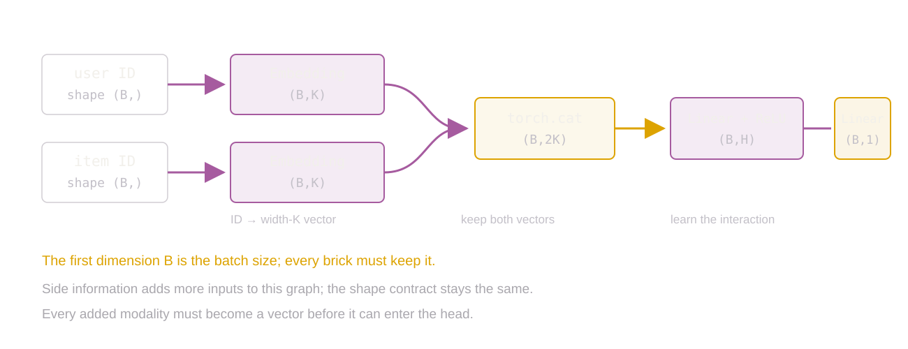
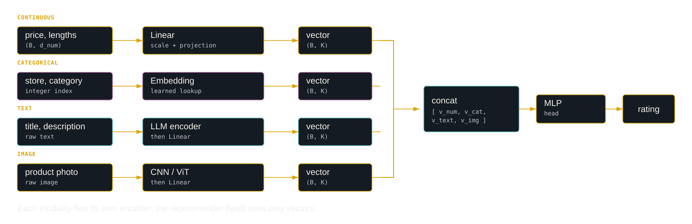
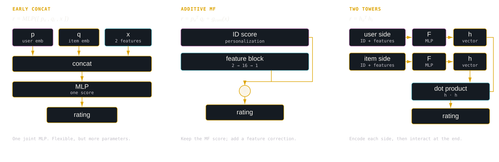
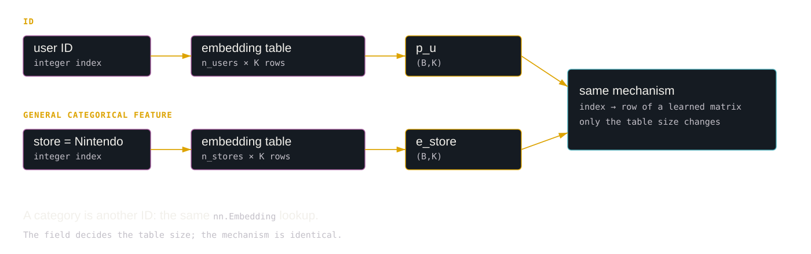
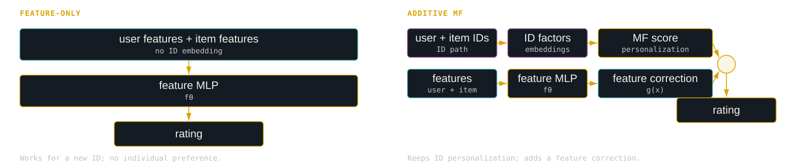
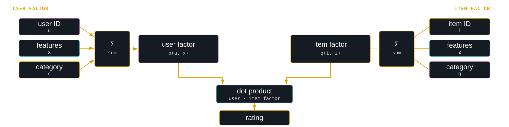
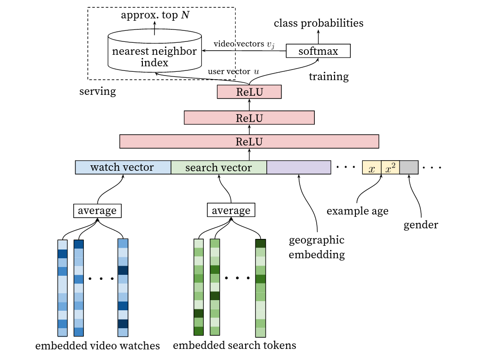
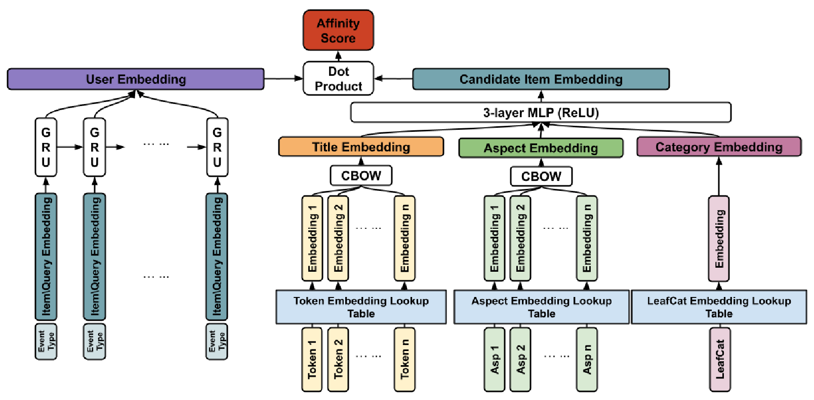
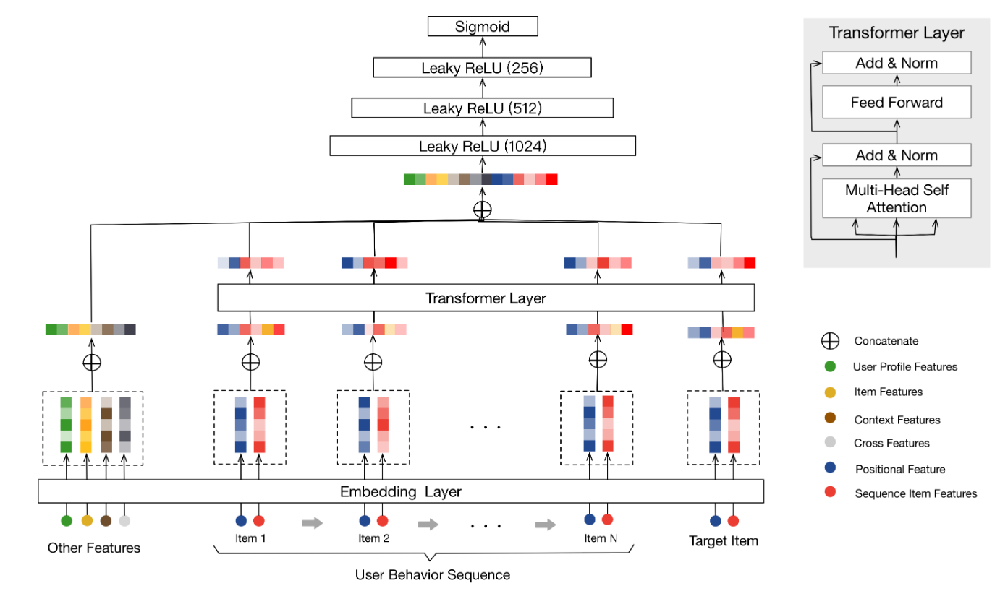

## The ID-only network is narrow {.lesson-slide}



<p class="lesson-takeaway">The ID-only graph has two inputs: a user ID and an item ID. Side information adds more inputs to the same graph.</p>

## Modern recommenders have more signals {.lesson-slide}

<div class="encoder-grid">
<div><span>CONTINUOUS</span><b>price, age, time</b><p>Numeric signals from profiles, content, or context.</p></div>
<div><span>CATEGORICAL</span><b>store, genre, device</b><p>Discrete labels that can become embeddings.</p></div>
<div><span>TEXT</span><b>title, description</b><p>Product or item text, encoded by an LLM or a smaller model.</p></div>
<div><span>IMAGE</span><b>photo, poster</b><p>Product or item images, encoded by a CNN or ViT.</p></div>
</div>

<div class="lesson-flow tight"><div>raw signal</div><i>→</i><div>encoder</div><i>→</i><div>vector</div><i>→</i><div>recommender</div></div>

<p class="lesson-takeaway">The modelling question is not “do we have IDs?” but “how do we encode and fuse all the information we have?”</p>

## The dataset: Amazon Reviews 2023 {.lesson-slide}

<p class="lesson-lede">A classroom subset of the <b>Video Games</b> category, built from the 5-core rating-only split. One row is one rating; product metadata joins on <code>item_id</code>.</p>

<div class="dataset-stats">
<div><b>2,000</b><span>products</span></div>
<div><b>39,796</b><span>ratings</span></div>
<div><b>29,209</b><span>users</span></div>
<div><b>300</b><span>product images</span></div>
</div>

<div class="lesson-grid three">
<div class="lesson-card"><span>RATINGS</span><b>1–5 stars</b><p>Continuous target; evaluate with RMSE.</p></div>
<div class="lesson-card"><span>PRODUCT METADATA</span><b>price + categories + text</b><p>Price, store, category path, title, description, features.</p></div>
<div class="lesson-card"><span>SPLIT</span><b>random 80 / 20 rows</b><p>Each rating is assigned to train or test at random; all users and items can appear in both.</p></div>
</div>

<p class="lesson-takeaway">Amazon Reviews 2023 (Hou et al., 2024). Rating-derived fields such as <code>average_rating</code> and <code>rating_number</code> are excluded; they would leak the target.</p>

## How each modality enters the network {.lesson-slide}



<p class="lesson-takeaway">Each block has a different encoder, but the head sees vectors. That is the whole “load side information into the network” pattern.</p>

## A concrete side-information table {.lesson-slide}

<table class="lesson-table side-table"><thead><tr><th>user</th><th>product</th><th>price</th><th>store</th><th>image</th><th>rating</th></tr></thead><tbody>
<tr><td>AHNZ…</td><td>Pro Evolution Soccer 2013</td><td>20.25</td><td>Konami</td><td>yes</td><td>5</td></tr>
<tr><td>AH5A…</td><td>Demon Slayer: Hinokami Chronicles</td><td>34.98</td><td>SEGA</td><td>yes</td><td>4</td></tr>
<tr><td>AFXA…</td><td>Sim Theme Park</td><td>35.00</td><td>Electronic Arts</td><td>no</td><td>2</td></tr>
<tr><td>AHJW…</td><td>Xbox One 1TB Console</td><td>349.99</td><td>Microsoft</td><td>no</td><td>1</td></tr>
</tbody></table>

<div class="lesson-grid three">
<div class="lesson-card"><span>USER SIDE</span><b>history</b><p>User ID and activity count from training interactions.</p></div>
<div class="lesson-card"><span>ITEM SIDE</span><b>metadata + text + image</b><p>Title/description, price, store/category, product photo.</p></div>
<div class="lesson-card"><span>LABEL</span><b>rating 1–5</b><p>A continuous star rating, evaluated with RMSE.</p></div>
</div>

<p class="lesson-takeaway">All four modalities are available before the rating. Exclude <code>average_rating</code> and <code>rating_number</code>: they leak the target.</p>

## The whole lecture in one picture {.lesson-slide}

<div class="encoder-grid">
<div><span>1 · REQUIRED</span><b>Continuous</b><p>Already a vector. Preprocess, then fuse.</p></div>
<div><span>2 · REQUIRED</span><b>Categorical</b><p>Encode, then learn an embedding table.</p></div>
<div><span>3 · OPTIONAL</span><b>Text</b><p>LLM encoder produces a dense vector.</p></div>
<div><span>4 · OPTIONAL</span><b>Image</b><p>CNN or ViT produces a dense vector.</p></div>
</div>

<div class="lesson-flow"><div>encode<br><b>raw feature → vector</b></div><i>→</i><div>fuse<br><b>early concat or two towers</b></div><i>→</i><div>evaluate<br><b>does it actually help?</b></div></div>

<p class="lesson-takeaway">The encoder changes with the modality. The <b>fusion</b> and <b>evaluation</b> questions do not.</p>

## Part 1 · Continuous features {.section-break}

<p>Already vectors — preprocess, then fuse.</p>

## Continuous features: price and user_count {.lesson-slide}

<div class="lesson-formula compact dense">$$x_{\text{cont}}=[\text{price}_z,\text{user count}_z]\in\mathbb R^2,\qquad g_{\text{cont}}(x)=\mathrm{Linear}_{16}(\mathrm{ReLU}(\mathrm{Linear}_2(x)))\in\mathbb R$$</div>

<div class="side-two-col even">
<div>
<table class="lesson-table side-table"><thead><tr><th>feature</th><th>raw</th><th>notebook transform</th><th>unseen / missing</th></tr></thead><tbody>
<tr><td><code>price</code></td><td>20.25</td><td><code>log1p</code> → train z-score</td><td>train median</td></tr>
<tr><td><code>user_count</code></td><td>12</td><td>training count → z-score</td><td>0</td></tr>
</tbody></table>
</div>
<div class="lesson-card"><span>NOTEBOOK BLOCK</span><b>2 → 16 → 1</b><p>Section 2 prepares the columns; <code>MFNetCont</code> adds this block to <code>MFNet</code>. Scalers and counts use training rows only.</p></div>
</div>

<div class="lesson-flow tight cont-flow">
<div>price + user_count<br><b>2 raw numbers</b></div>
<i>→</i>
<div>log1p + z-score<br><b>training only</b></div>
<i>→</i>
<div>concat<br><b>x<sub>cont</sub> ∈ ℝ²</b></div>
<i>→</i>
<div>2 → 16 → 1<br><b>g<sub>cont</sub>(x)</b></div>
</div>

<p class="lesson-takeaway"><code>X[&quot;cont&quot;]</code> has exactly these two columns. The text-length columns <code>description_len</code> and <code>feature_len</code> are not used here.</p>

## Three ways to fuse continuous features {.lesson-slide}



<p class="lesson-takeaway"><b>Early concat</b> lets one MLP learn all interactions; <b>additive MF</b> keeps the ID score and adds a feature correction; <b>two towers</b> encode each side separately before the dot product.</p>

## Part 2 · Categorical features {.section-break}

<p>A category is an ID. An embedding is a learned lookup table.</p>

## A category is an ID {.lesson-slide}



<p class="lesson-takeaway">User ID, store, category — the same <code>nn.Embedding</code> lookup; only the table size changes.</p>

## Continuous + categorical fusion {.lesson-slide}


<p class="lesson-takeaway">The recommender only sees vectors. Swapping an encoder should not change the fusion block.</p>

## Part 3 · Fusion architectures {.section-break}

<p>Same encoders, different interaction.</p>

## Three ways to use side information {.lesson-slide}

<div class="lesson-grid three">
<div class="lesson-card"><span>FEATURES ONLY</span><b class="side-eq">$f(x_u,z_i)$</b><p>Handles new IDs, but may miss individual preferences.</p></div>
<div class="lesson-card"><span>ADD TO MF</span><b class="side-eq">$p_u^\top q_i+f(x_u,z_i)$</b><p>Keeps personalized ID factors and adds a feature contribution.</p></div>
<div class="lesson-card"><span>SIDE-AWARE FACTORS</span><b class="side-eq">$p(u,x_u)^\top q(i,z_i)$</b><p>Builds each factor from ID and features together.</p></div>
</div>

<p class="lesson-small">Use features-only when IDs are weak; additive MF when IDs are strong; side-aware factors when both sides have rich features.</p>

<p class="lesson-takeaway">The third approach makes the interaction depend on the features on <b>both</b> sides.</p>

## Feature-only vs additive MF {.lesson-slide}

<div class="lesson-formula compact dense">$$
\begin{aligned}
\text{feature-only:}\quad & \widehat r_{ui}=f_\theta(x_u,z_i)\\
\text{additive MF:}\quad & \widehat r_{ui}=\mu+a_u+b_i+p_u^\top q_i+f_\theta(x_u,z_i)
\end{aligned}
$$</div>



<p class="lesson-takeaway"><b>Feature-only</b> works for a new ID but has no individual preference. <b>Additive MF</b> keeps the ID score and adds a feature correction — the safest first model.</p>

## Side-aware factors {.lesson-slide}

<div class="lesson-formula compact dense">$$
\begin{aligned}
p(u,x_u)&=p_u+A x_u+e_{c(u)}\\
q(i,z_i)&=q_i+B z_i+e_{g(i)}\\
\widehat r_{ui}&=p(u,x_u)^\top q(i,z_i)
\end{aligned}
$$</div>



<p class="lesson-takeaway">Features and category embeddings build each factor; the ID term is a learned residual. A new ID sets the residual to zero, but the feature path still produces a vector.</p>

## Two-tower architecture {.lesson-slide}


<p class="lesson-takeaway">Each tower learns nonlinear interactions <b>within</b> its side; the final layer learns the interaction <b>across</b> sides.</p>

## Part 4 · Train, evaluate, diagnose {.section-break}

<p>The model is only as good as the split.</p>

## Four questions and the loss {.lesson-slide}

<div class="lesson-grid four">
<div class="lesson-card"><span>1 · MODEL</span><b>ID score + one block per modality</b><p>Start with <code>MFNet</code>; add only the blocks the data supports.</p></div>
<div class="lesson-card"><span>2 · HYPERPARAMETERS</span><b>$K$, hidden, learning rate, epochs</b><p>Choose before fitting; tune on validation.</p></div>
<div class="lesson-card"><span>3 · CRITERION</span><b>mean squared error</b><p>MSE on the observed 1–5 ratings.</p></div>
<div class="lesson-card"><span>4 · LEARNED</span><b>tables + blocks</b><p>ID/category embeddings, biases, and the additive blocks.</p></div>
</div>

<div class="lesson-formula compact">$$\mathrm{L}(\theta)=\frac1{|\Omega|}\sum_{(u,i)\in\Omega}(r_{ui}-\widehat r_{ui})^2$$</div>

<p class="lesson-takeaway">One MSE trains the ID tables and every side-information block. Select hyperparameters on validation.</p>

## One dict, one named input per modality {.lesson-slide}

<div class="lesson-formula compact dense">$$
X=\{\mathrm{ids}:(N,2),\ \mathrm{cont}:(N,2),\ \mathrm{cat}:(N,3),\ \mathrm{text}:(N,384),\ \mathrm{image}:(N,512)\}
$$</div>

<div class="lesson-flow tight">
<div><code>X[&quot;ids&quot;]</code><br><b>user, item</b></div><i>→</i>
<div><code>forward(ids, ...)</code><br><b>named argument</b></div><i>→</i>
<div><code>MFNet</code><br><b>base score</b></div>
</div>

<div class="lesson-grid three">
<div class="lesson-card"><span>WHY A DICT</span><b>one key per modality</b><p>A new block adds a key; it does not move column positions.</p></div>
<div class="lesson-card"><span>SKORCH</span><b>keys become arguments</b><p><code>X[&quot;cont&quot;]</code> is passed to <code>forward(..., cont)</code>.</p></div>
<div class="lesson-card"><span>MODEL</span><b>take only what you need</b><p><code>MFNet</code> uses <code>ids</code>; <code>MFNetText</code> also uses <code>text</code>.</p></div>
</div>

<p class="lesson-takeaway">A new modality is a new dictionary key and a new named argument — not a new column index.</p>

## A PyTorch implementation sketch {.lesson-slide .lesson-code .side-code-sm .sketch-code}

```python
class MFNetCont(MFNet):
    def __init__(self, n_users, n_items, K=16, mu=0.0, d_cont=2):
        super().__init__(n_users, n_items, K, mu)
        self.cont = nn.Sequential(
            nn.Linear(d_cont, 16), nn.ReLU(), nn.Linear(16, 1)
        )

    def forward(self, ids, cont):
        return super().forward(ids) + self.cont(cont)
```

<p class="lesson-small">For this model, <code>X</code> only needs <code>ids</code> and <code>cont</code>; later models receive larger dicts.</p>

<p class="lesson-takeaway">One subclass, one new block. The dict keys select the named arguments; <code>skorch</code> handles the training loop and prediction.</p>

## A random row split {.lesson-slide}

<div class="lesson-grid three">
<div class="lesson-card"><span>SPLIT</span><b>80 / 20 random rows</b><p>31,836 train rows · 7,960 test rows. No user or item is deliberately removed.</p></div>
<div class="lesson-card"><span>WHAT IT MEASURES</span><b>interpolation</b><p>IDs are not held out; most test rows reuse users and items seen in training.</p></div>
<div class="lesson-card"><span>WHAT IT DOES NOT</span><b>new-item generalization</b><p>A random split does not test a genuinely new product or a new user.</p></div>
</div>

<div class="lesson-grid">
<div class="lesson-card"><span>SAFE</span><b>fit preprocessing on training rows</b><p>Scalers and rating summaries use training rows only; ID vocabularies can use the catalogue.</p></div>
<div class="lesson-card"><span>LEAKY</span><b>rating-derived features</b><p>Rating mean, rating count, or quantile computed from the target leaks even in a random split.</p></div>
</div>

<p class="lesson-takeaway">The notebook uses a random 80/20 split, so report test RMSE and describe it as in-distribution interpolation.</p>

## Baselines and ablation {.lesson-slide}

<p class="lesson-lede">Random 80/20 row split: 31,836 train rows · 7,960 test rows. Select on validation; report test once. Lower RMSE is better.</p>

<div class="results-layout">
<div>
<table class="lesson-table side-table results-table"><thead><tr><th>model</th><th>added input</th><th>validation RMSE</th><th>test RMSE</th></tr></thead><tbody>
<tr><td>MFNet</td><td>IDs only</td><td>1.1644</td><td>1.1587</td></tr>
<tr><td>&plus; continuous</td><td>price + user_count</td><td>1.1656</td><td>1.1589</td></tr>
<tr><td>&plus; categorical</td><td>store + category path</td><td>1.1635</td><td>1.1598</td></tr>
<tr><td>&plus; text</td><td>MiniLM title + description</td><td><b>1.1589</b></td><td><b>1.1535</b></td></tr>
</tbody></table>
<p class="lesson-small">Image subset (300 products): text only <b>1.1437</b> → + image <b>1.1438</b>. Not comparable with the full table.</p>
</div>
<div class="result-stack">
<div class="result-card gain"><span>CLEAR GAIN</span><b>&plus; text</b><p>0.0052 lower test RMSE than MFNet.</p></div>
<div class="result-card flat"><span>NO RELIABLE GAIN</span><b>&plus; continuous / categorical</b><p>Changes are tiny and do not hold on test.</p></div>
<div class="result-card neutral"><span>NEUTRAL</span><b>&plus; image</b><p>+0.0001 on the image subset.</p></div>
</div>
</div>

<p class="lesson-takeaway">More side information is not automatically better. On this split, text is the only clear gain; the image block is neutral.</p>

<p class="lesson-small">Intuition: with a random split the item ID is already seen in training, so price and category add little beyond the ID; text still adds product semantics.</p>

## Part 5 · Text side information {.section-break}

<p><span class="optional-badge">Optional</span> Product text → embedding → a small additive block.</p>

## Text: what goes in {.lesson-slide}

<div class="side-two-col even">
<div>
<table class="lesson-table side-table"><thead><tr><th>field</th><th>example</th><th>why</th></tr></thead><tbody>
<tr><td><code>title</code></td><td>Pro Evolution Soccer 2013</td><td>short, high signal</td></tr>
<tr><td><code>description</code></td><td>long product copy</td><td>use cases and context</td></tr>
<tr><td><code>features</code></td><td>bullet list</td><td>structured attributes</td></tr>
</tbody></table>
<div class="lesson-formula compact dense">$$\text{text}_i=\text{title}_i\;\|\;\text{description}_i\;\|\;\text{features}_i$$</div>
<p class="lesson-small">One string per <code>item_id</code>: 2,000 products, one embedding each.</p>
</div>
<div class="lesson-stack">
<div class="lesson-card"><span>USE</span><b>product text</b><p>Title, description, and feature bullets are available before the rating.</p></div>
<div class="lesson-card"><span>DO NOT USE</span><b>review text</b><p>Review title/text is written together with the star rating; it leaks the target.</p></div>
</div>
</div>

<p class="lesson-takeaway">One string per product, built from product metadata only. Review text is not a feature.</p>

## Text: the feature-extraction pipeline {.lesson-slide .lesson-code .side-code-sm .text-code}

```python
# Colab: !pip -q install transformers
import numpy as np
from transformers import pipeline

embed = pipeline("feature-extraction", model="sentence-transformers/all-MiniLM-L6-v2")
texts = (items.title.fillna("") + " " +
         items.description.fillna("") + " " +
         items.features.fillna("")).tolist()
out = embed(texts, batch_size=64,
            truncation=True, max_length=256)
# out[i][0].shape -> (n_tokens, 384)
text_vectors = np.array([np.mean(o[0], axis=0) for o in out])  # (n_items, 384)
```

<div class="lesson-flow tight text-flow">
<div>one string<br><b>title + description + features</b></div><i>→</i>
<div>tokenizer<br><b>truncate at 256</b></div><i>→</i>
<div>MiniLM<br><b>(n_tokens, 384)</b></div><i>→</i>
<div>mean pool<br><b>(384,)</b></div>
</div>

<p class="lesson-takeaway"><code>feature-extraction</code> returns one vector per token, not one vector per product. Mean pooling turns it into a single 384-d embedding.</p>

## Text: append the vector and add a block {.lesson-slide}

<div class="lesson-formula compact dense">$$
\begin{aligned}
\widehat r_{ui}&=\text{MFNet}(u,i)+g_{\text{cont}}+g_{\text{cat}}+g_{\text{text}}(e_i)\\
g_{\text{text}}(e)&=\mathrm{Linear}_{16}(\mathrm{ReLU}(\mathrm{Linear}_{32}(e)))\in\mathbb R
\end{aligned}
$$</div>

<p class="lesson-small">New input: <code>X[&quot;text&quot;] = e_text</code>, shape <code>(N, 384)</code>. <code>MFNetText.forward(ids, cont, cat, text)</code>.</p>

<div class="lesson-flow tight">
<div>text embedding<br><b>e<sub>i</sub> ∈ ℝ<sup>384</sup></b></div><i>→</i>
<div>projection<br><b>384 → 32</b></div><i>→</i>
<div>text block<br><b>32 → 16 → 1</b></div><i>→</i>
<div>additive correction<br><b>+ g<sub>text</sub>(e<sub>i</sub>)</b></div>
</div>

<p class="lesson-small">Trainable parameters: 12,320 + 528 + 17 ≈ 12.9k; MiniLM stays frozen at ~22M.</p>

<p class="lesson-takeaway">This is <code>MFNetText</code>: one projection, one small block, added to the existing score. The MiniLM encoder stays frozen.</p>

## Text: frozen, fine-tuned, or fused {.lesson-slide}

<div class="lesson-grid three">
<div class="lesson-card"><span>FROZEN</span><b>start here</b><p>Precompute 2,000 × 384; train only the projection and block. Cheap and reproducible.</p></div>
<div class="lesson-card"><span>FINE-TUNED</span><b>only with evidence</b><p>Update MiniLM only when the domain is specialized and frozen features clearly underperform.</p></div>
<div class="lesson-card"><span>FUSED</span><b>project first</b><p>Project 384 → 32, then add or concat. L2-normalize if using cosine-style retrieval.</p></div>
</div>

<div class="lesson-grid four">
<div class="lesson-card"><span>BATCH</span><b>64</b><p>Embed in batches; cache the matrix.</p></div>
<div class="lesson-card"><span>LENGTH</span><b>256 tokens</b><p>Truncate long descriptions.</p></div>
<div class="lesson-card"><span>JOIN</span><b>item_id</b><p>One embedding per product; map to rating rows.</p></div>
<div class="lesson-card"><span>COST</span><b>one pass</b><p>No encoder call at serving time.</p></div>
</div>

<p class="lesson-takeaway">Freeze first, cache the 2,000 embeddings, and measure on the same random split. Fine-tune only with evidence.</p>

## Part 6 · Image side information {.section-break}

<p><span class="optional-badge">Optional</span> Product photo → 512-d vector → a small additive block.</p>

## Image: what goes in {.lesson-slide}

<div class="side-two-col">
<div>

<p class="lesson-caption">One of the 300 product photos in the subset.</p>
</div>
<div class="lesson-stack">
<div class="lesson-card"><span>SOURCE</span><b>image_path</b><p>Prefix with the local dataset folder; in Colab, prefix with the GitHub <code>BASE</code> URL.</p></div>
<div class="lesson-card"><span>SUBSET</span><b>300 products</b><p>One embedding per product; the image ablation uses only rating rows for these products.</p></div>
<div class="lesson-card"><span>LEAKAGE</span><b>available before the rating</b><p>The product photo is metadata, not review content. Do not use review images or rating-derived fields.</p></div>
</div>
</div>

<p class="lesson-takeaway">Only a subset has an image, so image results are not directly comparable with the full-table numbers.</p>

## Image: the feature-extraction pipeline {.lesson-slide .lesson-code .side-code-sm .image-code}

```python
from transformers import pipeline

embed_image = pipeline(
    "image-feature-extraction",
    model="microsoft/resnet-18",
)

image_items = items[items.image_path.notna()]
paths = [f"{LOCAL or BASE}/{p}" for p in image_items.image_path]

image_vectors = np.array(
    embed_image(paths, batch_size=32, pool=True)
).reshape(len(paths), -1)
image_vectors /= np.linalg.norm(image_vectors, axis=1, keepdims=True)
image_emb = pd.DataFrame(image_vectors, index=image_items.item_id)
d_image = image_emb.shape[1]   # 512
```

<div class="lesson-flow tight image-flow">
<div>image path / URL<br><b>300 products</b></div><i>→</i>
<div>ResNet18<br><b>frozen backbone</b></div><i>→</i>
<div>feature map<br><b>(1, 512, 1, 1)</b></div><i>→</i>
<div>flatten<br><b>(512,)</b></div>
</div>

<p class="lesson-small"><code>pool=True</code> averages the 7×7 feature map; each vector is then L2-normalized.</p>

<p class="lesson-takeaway"><code>image-feature-extraction</code> returns a spatial tensor; flatten it to one 512-d vector per product.</p>

## Image: append the vector and add a block {.lesson-slide}

<div class="lesson-formula compact dense">$$
\begin{aligned}
\widehat r_{ui}&=\text{MFNet}(u,i)+g_{\text{cont}}+g_{\text{cat}}+g_{\text{text}}(e_i)+g_{\text{image}}(v_i)\\
g_{\text{image}}(v)&=\mathrm{Linear}_{16}(\mathrm{ReLU}(\mathrm{Linear}_{32}(v)))\in\mathbb R
\end{aligned}
$$</div>

<p class="lesson-small">New input: <code>X[&quot;image&quot;] = v_i</code>, shape <code>(N, 512)</code>. <code>MFNetImage.forward(ids, cont, cat, text, image)</code>.</p>

<div class="lesson-flow tight image-flow">
<div>image embedding<br><b>v<sub>i</sub> ∈ ℝ<sup>512</sup></b></div><i>→</i>
<div>projection<br><b>512 → 32</b></div><i>→</i>
<div>image block<br><b>32 → 16 → 1</b></div><i>→</i>
<div>additive correction<br><b>+ g<sub>image</sub>(v<sub>i</sub>)</b></div>
</div>

<p class="lesson-small">Trainable: 16,416 + 528 + 17 ≈ 17k; ResNet18 stays frozen. Evaluate on the 300-image subset.</p>

<p class="lesson-takeaway"><code>MFNetImage</code> inherits <code>MFNetText</code> and adds one projection plus one block.</p>

## Image: frozen, fine-tuned, or multimodal {.lesson-slide}

<div class="lesson-grid three">
<div class="lesson-card"><span>FROZEN</span><b>start here</b><p>Precompute 300 × 512; train only the projection and image block.</p></div>
<div class="lesson-card"><span>FINE-TUNED</span><b>domain shift</b><p>Fine-tune the last block only when you have enough images and compute.</p></div>
<div class="lesson-card"><span>MULTIMODAL</span><b>early or late</b><p>Concat for ranking; image tower for retrieval; CLIP-style alignment for zero-shot items.</p></div>
</div>

<div class="lesson-grid four">
<div class="lesson-card"><span>INPUT</span><b>300 images</b><p>Paths or URLs; batch 32.</p></div>
<div class="lesson-card"><span>FEATURE</span><b>512-d unit vector</b><p>Flatten the pooled ResNet map; L2-normalize.</p></div>
<div class="lesson-card"><span>BLOCK</span><b>512 → 32</b><p>then 16 → 1; small additive head.</p></div>
<div class="lesson-card"><span>COST</span><b>one pass</b><p>Cache embeddings; no CNN at serving time.</p></div>
</div>

<p class="lesson-takeaway">Image subset: text only <b>1.1437</b> → + image <b>1.1438</b>. No gain; freeze first and measure.</p>

## Part 7 · Industry systems {.section-break}

<p><span class="optional-badge">Optional</span> Same pattern at scale.</p>

## YouTube: two-tower retrieval {.lesson-slide}

<div class="side-two-col image-slide">
<div class="paper-figure"></div>
<div class="lesson-stack">
<div class="lesson-card"><span>USER TOWER</span><b>watch + search + context</b><p>Average embeddings, then ReLU layers produce the user vector <i>u</i>.</p></div>
<div class="lesson-card"><span>ITEM TOWER</span><b>video vectors</b><p>Softmax trains the item side; nearest-neighbour search serves candidates.</p></div>
<div class="lesson-card"><span>SIDE INFO</span><b>history is a feature</b><p>Watch/search sequences and demographics enter before the final interaction.</p></div>
</div>
</div>

<p class="lesson-takeaway">The two-tower pattern is a retrieval architecture first; the same encoders can feed a ranking model later.</p>

## eBay: sequence plus content {.lesson-slide}

<div class="side-two-col image-slide">
<div class="paper-figure"></div>
<div class="lesson-stack">
<div class="lesson-card"><span>USER TOWER</span><b>event sequence → GRU</b><p>Clicks and purchases become a user embedding.</p></div>
<div class="lesson-card"><span>ITEM TOWER</span><b>text + category → MLP</b><p>Title and aspect CBOW embeddings plus a leaf-category embedding.</p></div>
<div class="lesson-card"><span>SCORE</span><b>dot product</b><p>Affinity between the user and candidate item embedding.</p></div>
</div>
</div>

<p class="lesson-takeaway">Same two-tower pattern: a sequence encoder on the user side, a text/category encoder on the item side.</p>

## Alibaba: behavior sequence + feature crossing {.lesson-slide}

<div class="side-two-col image-slide">
<div class="paper-figure"></div>
<div class="lesson-stack">
<div class="lesson-card"><span>INPUT</span><b>profile + item + context</b><p>Other features and the user behavior sequence enter the embedding layer.</p></div>
<div class="lesson-card"><span>SEQUENCE</span><b>Transformer</b><p>Multi-head self-attention models the order of past items.</p></div>
<div class="lesson-card"><span>OUTPUT</span><b>click probability</b><p>Concatenate target item with sequence output; MLP + sigmoid.</p></div>
</div>
</div>

<p class="lesson-takeaway">Alibaba uses a sequence Transformer plus feature crossing; Wide &amp; Deep and DeepFM are earlier early-fusion variants.</p>

## Retrieval vs ranking, and the feature store {.lesson-slide}

<table class="lesson-table side-table"><thead><tr><th></th><th>retrieval</th><th>ranking</th></tr></thead><tbody>
<tr><td>goal</td><td>millions → hundreds</td><td>hundreds → top few</td></tr>
<tr><td>model</td><td>two-tower, dot product</td><td>richer MLP, crosses, context</td></tr>
<tr><td>latency</td><td>milliseconds</td><td>tens of milliseconds</td></tr>
<tr><td>features</td><td>available for every candidate</td><td>rich user/item/context features</td></tr>
</tbody></table>

<div class="lesson-grid">
<div class="lesson-card"><span>FEATURE STORE</span><b>offline / online</b><p>The same feature definition must be available at training and serving time.</p></div>
<div class="lesson-card"><span>FRESHNESS</span><b>time matters</b><p>A rating mean computed yesterday is not the same feature today.</p></div>
</div>

<p class="lesson-takeaway">A side-information model is also a data-engineering contract. Training-serving skew is a modelling bug.</p>

## Summary {.lesson-slide}

<div class="lesson-flow"><div>ID-only MF<br><b>personalization</b></div><i>→</i><div>continuous + categorical<br><b>tabular side info</b></div><i>→</i><div>text + image<br><b>optional encoders</b></div><i>→</i><div>two-tower<br><b>learned fusion</b></div><i>→</i><div>random split<br><b>honest evaluation</b></div></div>

<div class="lesson-grid three">
<div class="lesson-card"><span>ENCODE</span><b>modality → vector</b><p>Scale, embed, or pretrain; the recommender sees vectors.</p></div>
<div class="lesson-card"><span>FUSE</span><b>early or late</b><p>Additive maps for interpretability; two towers for new entities and retrieval.</p></div>
<div class="lesson-card"><span>EVALUATE</span><b>match the claim</b><p>Random split: report test RMSE. Add new-entity splits only for generalization claims.</p></div>
</div>

<p class="lesson-takeaway">Side information is a representation strategy, a fusion choice, and an evaluation protocol — and on this dataset, only text improved test RMSE.</p>

## References {.lesson-slide}

<ul class="lesson-list">
<li>Covington, Adams &amp; Sargin (2016). <i>Deep Neural Networks for YouTube Recommendations</i>.</li>
<li>Wang, Brovman &amp; Madhvanath (2021). <i>Personalized Embedding-based E-commerce Recommendations at eBay</i>.</li>
<li>Hou et al. (2024). <i>Bridging Language and Items for Retrieval and Recommendation</i> (Amazon Reviews 2023).</li>
<li>Chen et al. (2019). <i>Behavior Sequence Transformer for E-commerce Recommendation in Alibaba</i>.</li>
<li>Cheng et al. (2016). <i>Wide &amp; Deep Learning for Recommender Systems</i>; Guo et al. (2017). <i>DeepFM</i>.</li>
<li>PyTorch <code>nn.Embedding</code>; scikit-learn <code>OneHotEncoder</code>, <code>StandardScaler</code>; Hugging Face <code>pipeline("feature-extraction")</code> and <code>pipeline("image-feature-extraction")</code>; Sentence Transformers <code>all-MiniLM-L6-v2</code>; <code>microsoft/resnet-18</code>; CLIP.</li>
</ul>
